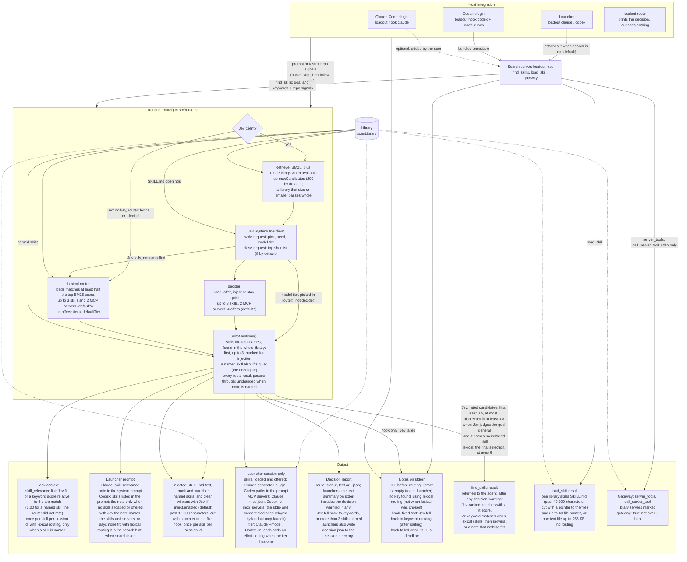

# loadout — design

## Problem

Installed skill listings add context even when the skills are irrelevant.
[B1](bench/RESULTS.md#b1-results-2026-10-07-what-installed-skills-cost-per-request)
measured about **10 tokens per added skill** in Claude Code, using generated
names. Codex caps its rendered listing: only **424** of **1,262** skills were
visible in the offline measurement; its token cost is not shown.

**loadout decouples library size from per-request cost.** A very cheap
System One model ([Jev](https://typesafe.ai/blog/introducing-system-one-models-and-jev))
looks at the task and the repo, then picks the model and a deliberately
over-inclusive shortlist of skills and MCP servers from a library that can be
arbitrarily large. The agent still makes the final call from the shortlist.

## Non-goals

- **No traffic interception.** loadout never sits between a CLI and its model
  provider, never forwards a CLI's auth headers, and never depends on private
  request formats. It uses only documented extension points (CLI flags,
  plugins, MCP, hooks). (Contrast: [jev-router](https://github.com/gargpratyush/jev-router) routes
  per turn through a loopback proxy on `ANTHROPIC_BASE_URL`.)
- **No per-turn tool swapping.** Tool definitions sit at the front of the
  prompt cache, so changing them per turn invalidates the cache.

## Architecture



Library edges: solid ones are read while routing, dotted ones when the output is
built. Each entry point filters the library before `route()` sees it (so before
retrieval, the lexical router and the named-skill scan): the launcher and
`loadout route` pass skills and MCP servers; the hook and `find_skills` over
`--http` pass skills; `find_skills` over stdio passes skills and servers marked
`"gateway": true`. `load_skill` and the gateway read the server's own library
without routing. Not drawn: the embedding index (it only feeds retrieval), the
hook's per-session state file (it makes the "once per session id" rules),
`loadout mcp-launch` (the relay Codex runs for library MCP servers) and
`loadout doctor` (read-only checks).

### Integration layers

loadout **adds** its selection to a session; it does not isolate one. The
user's own skills, plugins, MCP servers and approval policies stay active.
Isolation needs per-CLI support that is not uniform yet (Claude Code has
`--strict-mcp-config`; Codex `exec` has `--ignore-user-config`).


| Layer | When | Claude Code | Codex |
|---|---|---|---|
| **Launcher** (v0.1) | once per session | `--model`, `--plugin-dir`, `--mcp-config` | `-m`, `-c` overrides |
| **Search server** (`loadout mcp`) | mid-session, on demand | `find_skills`, `load_skill`, gateway to library MCP servers; attached by the launcher | same — Codex speaks MCP |
| **Prompt hook** (`loadout hook claude\|codex`) | every prompt | D10 plugin (`plugins/loadout`): `UserPromptSubmit` adds the skills that fit as context (cache-safe: appended to the user turn), once per skill per session | same contract, once trusted with `/hooks`; untested ([hosts](docs/hosts.md)) |
| **HTTP** (`loadout mcp --http`) | remote hosts | — | ChatGPT chat, behind an HTTPS tunnel; skills only, optional bearer token |

The launcher fixes the session's tool set up front, which also keeps the prompt
cache intact. The gateway is the escape hatch when the router misses.

### Library

Capabilities live in `~/.loadout/library`, a directory no agent loads by
itself. Users install skills and MCP servers there for loadout to select.

- **Skills:** `skills/<name>/SKILL.md` (the [Agent Skills](https://agentskills.io)
  format: YAML frontmatter with `name` and `description`).
- **MCP servers:** `mcp.json`, standard `{"mcpServers": {...}}` plus an
  optional `description` per server (used for routing, stripped on launch).

Skills the user installed directly into `~/.claude/skills` stay always-on;
loadout does not touch them.

### Router

Two Jev requests, following TypeSafe's own
[skill-suggestion recipe](https://docs.typesafe.ai/cookbooks/skill_suggestion):
a cheap ranking over everything, then a close look at a few. Jev answers
literal, atomic questions; every decision rule is code (`decide()` in
`src/route.ts`), so it can be tuned on stored answers without new API calls.

1. **Retrieve.** BM25 over name + description, fused (RRF) with local
   `bge-small-en` embeddings when the optional `@huggingface/transformers` is
   installed; the query is the task text plus repo signals (name, top-level
   files, dependencies, languages). Keeps the top `maxCandidates` (200); a library no larger than that goes whole. Local
   and free: the library is embedded once (about a minute for 1,000 skills; new
   skills at `loadout add`). On the synthetic benchmark the embeddings added
   nothing; on realistic, detailed requests they kept the judge's best skill in
   the candidates 87% of the time vs 80% for BM25 alone, because long prompts
   dilute keyword scores (see [bench/RESULTS.md](bench/RESULTS.md), v4).
2. **Wide request.** All in one call, evaluated in parallel:
   - `pick`: one Choice over the candidates plus `no_skill_needed`. Its
     probabilities are relative, which separates lookalikes.
   - two Nouls about the request: does an expert follow a documented
     procedure, tool or service workflow? Could a strong general programmer
     do it with only reading/editing code and ordinary commands (inverted)?
   - `model_tier`: a Choice over small / medium / large, with structured
     criteria (what, signals, not for), after jev-router.
3. **Close request.** The top 8 wide picks are reread with their full
   description and the opening of their `SKILL.md`. Per candidate:
   - a graded Score: unrelated / same area but no help / helps with part /
     made for exactly this. The expected level ÷ 3 is the **fit** shown to the
     user (0–1).
   - a Noul: is this skill *specifically* about something the request names
     (a product, service, tool, format, framework, project process) rather than
     a general coding practice?

   Plus one Choice among the 8 and `no_skill_needed`, for ordering (**share**).
4. **Decide** (`decide()`, rules tuned on dev splits):
   - **need** = mean(procedure, ¬general, specificity of the top candidate);
     below 0.5, nothing is loaded or offered;
   - **load** candidates with P(made for exactly this) ≥ 0.8 and share ≥ 0.1,
     plus the **winner** of the close comparison (share ≥ 0.5) when its
     expected fit is ≥ 0.7; at most 3 skills and 2 MCP servers. The winner
     rule came from the judged sweep of detailed requests (v4): a long request
     asks for several things, so the right format or domain skill is "helps with
     part" while clearly the best, whereas generic process skills ("plan, then
     implement") match a step-by-step request "exactly";
   - **offer** up to 4 more skills with fit ≥ 0.7, marked optional, so the
     agent's scope is broader than the router's pick;
   - **inject** the top skill's full SKILL.md when it is a clear winner (wide
     pick ≥ 0.5, close share ≥ 0.8, P(exact) ≥ 0.95). On the
     [v3 synthetic rows](bench/RESULTS.md#injection), it fires on 77% of rows
     with a gold skill; 99.0% of all injections are gold (99.5% on rows with
     one). On [v4 realistic requests](bench/RESULTS.md#v4-2026-10-06-realistic-requests-on-the-real-library-judged),
     84% (67–93, 95% Wilson interval) of injected skills are useful on test.
5. **Mentions override.** A skill in the whole library, not only the
   candidates, that the user explicitly names is loaded and injected (unless
   injection is off) whatever the router or gate said, in request order, at
   most 3 (more gives a warning).
   - Counted: `/tdd`, `@pdf`, `$pdf`, `/loadout:pdf`, a multi-part name as
     written (`zx-ledger-reconcile`), or the name next to "skill" ("the pdf skill").
   - Not counted: path segments (`/pdf/report.py`), negations ("do not use
     /pdf"), and plain prose.
   - If several installed skills share the name, the one the router rated best
     is used, and it replaces the other copies.
6. **Tell the agent where to look**, without forcing it (TypeSafe's measured
   wording), via `--append-system-prompt` for Claude Code. Codex gets it in the
   prompt only when no skill is loaded or offered; otherwise the prompt lists
   the loaded skills, then the offered ones under "Also available if needed".
   Without Jev (no key, `--lexical`, `"router": "lexical"`, or Jev down) the
   note names no skills: it is only the search hint, and only when search is
   on, so a Codex prompt with no skills and search off is the bare task:

   ```
   <skill_relevance>
   Most relevant to the current request: loadout:agent-browser. Also available if
   needed: loadout:playwright-debug. Ignore this if it does not fit what the user
   actually asked for.
   </skill_relevance>
   ```

   Injected skills go into the **user turn**, never the system prompt, as
   `<skill name="…" source="…" trust="third-party">` blocks:
   - capped at 12k characters, with a pointer to the full file;
   - the block cannot close itself early, and its header attributes are escaped;
   - the framing says the text is guidance that cannot override the user, the
     agent's instructions or approval settings.

   The only addition outside the user turn is one line saying such blocks are
   reference material: in the system prompt for Claude Code, in the prompt for
   Codex. Delimiters do not make prompt injection impossible: injection
   raises the authority of third-party text compared with listing the skill, so
   it is limited to clear winners and explicit mentions, and can be turned off
   (`"inject": {"enabled": false}`).
7. **Degrade, don't block.** Jev responses are validated; rate limits, server
   errors and timeouts are retried once; if Jev is still unavailable, loadout
   falls back to keyword ranking with a visible warning.

Cost per decision: **$0.00082**, 0.95 s on the
[v3 synthetic 20,000-skill test](bench/RESULTS.md#test-split);
**$0.0011** on [v4 realistic requests](bench/RESULTS.md#v4-2026-10-06-realistic-requests-on-the-real-library-judged).
Measured limits (2026-10-05): no per-request question cap below 200, state
billed once, Choice capped at 255 options, 64k-token context.

Things that did not work, and why they are not used:
- **One yes/no question per candidate (v1).** Scores came back compressed
  (gold ≈ 0.95, the best wrong candidate on a no-skill task ≈ 0.935), so no
  threshold could separate them; v1 loaded ~9 skills per task and loaded
  something on 80% of tasks that needed nothing.
- **Request-only "is this named/specialised?" questions.** `need_named`
  scored 0.958 on gold tasks and 0.946 on no-skill tasks (AUC 0.77): every
  request names *something*. Replaced by the per-candidate specificity
  question. Alternatives proposed in review ("prescribed steps not given",
  "project convention not given", "calls an external service") separated
  worse (AUC 0.83–0.88) than the current pair (0.97 each).

### Search server (`loadout mcp`)

The launcher decides once, up front. When the work drifts (a debugging
session turns into "now write the release notes"), the agent can search the
library itself, in its own words, through MCP:

- **`find_skills(goal, keywords?)`** runs the same two Jev requests on the
  agent's goal. It returns at most 5 matches with fit ≥ 0.5, one line each
  (key, fit, a 180-character description), with the exact next call. The need
  gate is softened, since the agent asked: when Jev judges the goal to be
  general work and the goal names no installed skill, only near-certain exact
  fits (P ≥ 0.8) are shown. Without Jev it returns keyword matches instead. Otherwise
  the answer says nothing fits and names the closest skill, so the agent does
  not load a near miss. About 1 s and $0.001 per search.
- The tool description and the server's `instructions` ask for a search
  before the first specialised step, even in a familiar domain, and again when
  the domain changes. Measured uptake is still partial (bench/RESULTS.md, v4),
  which is why the launcher's upfront pick stays the main path.
- **`load_skill(skill, file?)`** returns the SKILL.md as attributed
  third-party reference material (the same framing as injection) plus a list of
  the skill's files. A file is read only inside the skill folder: no `..`, no
  absolute paths, no links, no binaries, 256 KB at most.
- **Gateway**: `server_tools` / `call_server_tool` reach the library's MCP
  servers, started on first use and kept for the session. Registered only when
  the library has servers marked `"gateway": true`, so otherwise the search
  server costs two tool definitions.

The search tools add **546 input tokens** per request in Claude Code. A
native listing of 50 skills with generated names adds about 477; B1
interpolates the crossover near 57 such skills. Real-name costs, router calls
and returned skills are not included ([B1](bench/RESULTS.md#b1-results-2026-10-07-what-installed-skills-cost-per-request)).

Approvals: the launcher pre-approves `find_skills` and `load_skill`
(Claude `--allowedTools`, Codex `tools.<tool>.approval_mode = "approve"`), and
the library MCP servers marked `autoApprove`. The two search tools only read the
user's own library. `call_server_tool` keeps the host's
prompt, which shows the server, tool and arguments.

### Prompt hook

[Search plus hook](bench/RESULTS.md#do-agents-use-what-they-are-given) raised
Claude Code's useful-skill use from **2 of 10** to **6 of 10** sessions. The
hook alone is not measured:
- each substantive prompt (not "yes" or "go on") is routed with the same two
  Jev requests;
- the skills that fit are listed once per session, as third-party metadata,
  with how to load them;
- a clear winner or a named skill is injected once.

Without Jev (no key, or Jev down) the hook adds nothing unless the prompt names
a skill.

It runs before the host sends the prompt, so it has a hard budget. It gives
up after 20 s with no output, never retries Jev, and only uses the cached
embedding index. Any error adds nothing.

See [SECURITY.md](SECURITY.md#prompt-hook) for data sent to TypeSafe.

### Router backends

- `jev` (default): TypeSafe official API, `TYPESAFE_API_KEY`.
- `lexical`: prefilter only, no network. For offline use and as a benchmark arm.

## Benchmark

Methods and reproduction: [bench/README.md](bench/README.md).
Measurements and caveats: [bench/RESULTS.md](bench/RESULTS.md).

## Open questions

- **Native Codex skills per session.** Codex 0.160 discovers skills in
  `~/.codex/skills`, plugins and project `.agents/skills`, but has no
  per-session extra skill root. Today selected skills are listed in the prompt
  with their paths (verified: Codex reads and follows them) and clear winners
  are injected.
- **Dynamic tool exposure.** The gateway exposes library MCP servers through
  one generic `call_server_tool`. MCP's `tools/list_changed` could add a
  server's real tools to the session instead (native schemas, per-tool
  approvals) on hosts that honour it.
- **Independent evaluation.** New held-out requests: [backlog C1](docs/loop/BACKLOG.md#c-skill-decision-making-router-quality).
- **The model tier.** Jev's tier choice is not evaluated yet.
