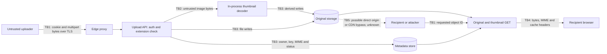

# File upload threat model — provisional launch review

Date: 2026-10-07. **Disposition: launch sign-off pending real-code and deployment review.**

## Scope and evidence limits

The supplied folder had no application source, repository instructions, dependency manifests, tests, deployment configuration, or upload data. `rg --files --hidden` with tool/config directories excluded returned no files; `git rev-parse --is-inside-work-tree` reported no repository. There is consequently **no confirmed vulnerability or mitigation in the actual product**, and no real application file/line references can be supplied.

Following the requested empty-folder fallback, this review uses a deliberately imperfect, small synthetic upload excerpt: [sample source](samples/sample_upload_source.txt), [deployment assumptions](samples/deployment_assumptions.json), [16 acceptance-test scenarios](samples/upload_cases.json), [small valid PNG](samples/pixel.png), and [HTML renamed as PDF](samples/invoice.pdf). The [multipart request](samples/upload-spoof.http) is an unsent example. Source is stored as text and is not a runnable application. No application code was changed; no fix was applied.

**Every code reference and finding below describes that synthetic excerpt only.** Negative findings mean a control is absent from the excerpt, not that deployment middleware lacks it. Reconcile each finding with the real routes, callers, middleware, database/schema, dependencies, worker code, storage policies and CDN configuration before accepting or closing it. The example's dictionary represents an unspecified metadata database; it is not evidence of real persistence behavior.

General review baseline: use several independent controls for permitted formats, content validation, generated storage keys, authorized access, bounded resource use and safe delivery. Extensions and client `Content-Type` alone do not establish content safety. [OWASP File Upload Cheat Sheet](https://cheatsheetseries.owasp.org/cheatsheets/File_Upload_Cheat_Sheet.html).

## Assumptions requiring confirmation

| Area | Working assumption | Consequence if wrong |
| --- | --- | --- |
| Upload actors | Signed-in users; malicious accounts are possible. Registration and roles unknown. | Public uploads increase abuse likelihood; invite-only access reduces exposure but does not establish file safety. |
| Access policy | Originals and thumbnails are private to owner or authorized recipients. | Intentional public sharing changes authorization requirements; document which objects may be public and how sharing/revocation works. |
| Identity | Signed cookie session; real login/session implementation unknown. | Verify session integrity, expiry, cookie scope and CSRF defense; bearer-token flows have different CSRF exposure. |
| Storage | Linux volume at `/srv/app-data/uploads`, outside application static directory; no direct web-server mapping assumed. | Object storage requires separate bucket, ACL, IAM, signed-URL, CDN and lifecycle review. A proxy alias can expose a private volume. |
| Delivery | TLS edge; files served on the application origin. Limits and cache rules unknown. | Same-origin active content threatens application sessions; a CDN can bypass authorization or retain revoked objects. |
| Processing | Synchronous Pillow thumbnails for JPEG/PNG; PDFs stored unchanged. | OCR, document converters, SVG/XML handling, extraction, scanners or remote imports add parser, network and command-execution boundaries. |
| Dependencies | Flask/Werkzeug/Pillow are illustrative; versions and native codecs unknown. | Current documentation explains APIs, not installed behavior or patch status. Require real lockfiles and runtime inventory. |
| Infrastructure | Volume permissions, worker egress, instance credentials, quotas, replica topology and monitoring unknown. | Code-level checks cannot establish storage privacy, least privilege or capacity protection. |

## Observed sample upload flow

All references in this section are to `samples/sample_upload_source.txt`.

| Stage | Sample behavior and evidence |
| --- | --- |
| Upload endpoint | `POST /api/uploads`, lines 21–28. Requires a session user ID and a nonempty multipart `file`; login itself is not included. |
| Validation | Sanitizes display name; final lowercased extension must be JPEG/PNG/PDF, lines 15 and 29–32. Reads the entire part before applying a 10 MiB file limit, lines 16 and 33–35. No actual PDF/content validation. |
| Storage | Generates UUID-based key; writes original bytes to fixed root, lines 14 and 36–40. Records owner, sanitized display name, client MIME and `ready` status, lines 41–47. |
| Image handling | Opens uploaded bytes and generates a 256×256 maximum thumbnail synchronously, lines 48–51. Original remains unchanged. No explicit decoded-pixel/frame/time budget or processing isolation. |
| Malware/document handling | No scanner, quarantine, PDF/XML parser, archive extraction, URL fetch or shell call, lines 21–52 and 75. Their absence is not a claim that raw files are safe. |
| Original delivery | `GET /uploads/<file_id>`, lines 55–65. Looks up record but does not check identity, owner or status; returns inline using client-supplied MIME. |
| Thumbnail delivery | `GET /uploads/<file_id>/thumbnail`, lines 68–73. Same missing access/status checks; fixed JPEG response type. |
| Other operations | No listing, replacement, deletion, bulk upload or presigned-upload endpoint supplied. Real counterparts must be included in the eventual review. |

`send_from_directory` confines a relative path to a fixed directory using safe joining; it does not authorize an object or prevent exposure through other serving paths. [Flask API reference](https://flask.palletsprojects.com/en/stable/api/#flask.send_from_directory).

## Assets, actors and trust boundaries

Assets: original files and derivatives; owner/tenant bindings and sharing policy; application sessions and user data; storage/database integrity; service availability and bandwidth/storage budget; worker credentials and internal services; audit evidence; recipients' browsers and workstations.

Actors: legitimate uploaders and recipients; anonymous internet clients; malicious authenticated users; attackers controlling a compromised account; operators and service identities; scanners/converters and storage/CDN providers that may receive confidential bytes.

TB1 crosses untrusted clients into the identity and request-processing boundary. TB2 crosses attacker-controlled content into native decoding in the application's own process. TB3 crosses API/worker identities into persistent files and ownership metadata. TB4 crosses untrusted uploaded content into a browser origin that may carry application privileges. TB5 represents an unverified alternate delivery path. A scanner or external converter would introduce another boundary for confidential bytes, verdict authenticity and worker privileges; neither is present in the sample.

## STRIDE assessment

Likelihood is qualitative under the assumptions: **High** = straightforward abuse by an ordinary client/account; **Medium** = additional conditions or crafted input; **Low** = strong existing constraint or no processing path. Impact: **Critical** = potential service/credential compromise; **High** = private-data exposure, session abuse or major outage; **Medium** = bounded cost, integrity or audit loss. These are assessment judgments, not measured probabilities. “Conditional” requires deployment or feature evidence. IDs map to the launch gates below. Evidence notation **S:23–25** means sample source lines 23–25; it never means production source.

### Spoofing

| ID / threat | Likelihood / impact | Sample mitigation and evidence | Recommended fix / disposition |
| --- | --- | --- | --- |
| S1 — Unauthenticated upload or account/session spoofing | Medium / High | **Partial:** rejects missing session user, S:23–25; session secret from environment, S:13. Login verification, secret strength, rotation and cookies unknown. | Verify trusted identity and tenant context, session expiry and secure cookie policy; reject anonymous/expired credentials. Conditional blocker, B0/B8. |
| S2 — CSRF uploads charged or attributed to a victim | Medium / High | **Unknown/absent in excerpt:** cookie auth S:23, multipart S:26; no explicit CSRF validation S:21–52. Browser cookie policy may reduce exposure but is unverified. | For cookie auth, enforce CSRF token or an appropriate validated origin policy, with cookie protections. Test cross-origin multipart POST, not just JSON requests. Conditional blocker, B8. |

### Tampering

| ID / threat | Likelihood / impact | Sample mitigation and evidence | Recommended fix / disposition |
| --- | --- | --- | --- |
| T1 — Extension/MIME spoofing or unrestricted actual content | High / High | **Partial:** final extension allowlist S:15,29–32. JPEG/PNG branch attempts decoding S:48–51; PDF branch accepts any bytes. Client MIME is retained S:45. An HTML body called `invoice.pdf` passes. | Define necessary formats; inspect content and validate with bounded format-specific processing. Require declared extension, detected format and permitted MIME to agree; derive delivery MIME server-side. Signatures alone do not exclude polyglots. Blocker, B2. |
| T2 — Filename traversal, absolute paths or archive Zip Slip | Low / High | **Mitigated for ordinary sample names:** display sanitization S:29; generated storage name S:36–39; downloads use fixed root S:60–62,73. No extraction S:75. Filesystem symlinks and permissions unknown. | Preserve generated keys and fixed root; test Linux/Windows names, encoded separators and containment. Prevent other principals from placing symlinks. If extraction is added, reject escaping members and symlinks. Follow-up; unsafe deployment paths would block B6. |
| T3 — Overwriting another user's original or derivative | Low / High | **Mostly mitigated for client-selected names:** UUID key S:36–37 and generated thumbnail S:51; owners cannot choose storage path. Write mode `wb` can replace an existing key S:39; metadata/storage updates are not transactional. | Use create-only writes or conditional object creation and unique database constraints. Replacement must authorize owner and create a new immutable version. Force a collision in a controlled test. Follow-up unless real replacement semantics permit cross-owner writes. |
| T4 — Publish before processing/scanning completes; verdict-object mismatch | High / High | **Not mitigated:** original written S:39–40, metadata marked `ready` S:46 before decoding S:49; GET ignores status S:55–73. No quarantine or immutable verdict binding. | Store privately as pending; validate/process/scan before atomic publication; readers require final clean state. Bind verdict to exact immutable bytes/version/hash; keep errors quarantined and clean up failures. Blocker, B4. |
| T5 — Malware or harmful document distribution | High / High | **Not mitigated:** unchanged originals S:39–40, PDFs skip processing S:48; no scanner S:75. Thumbnail re-encoding does not sanitize the downloadable original. | For the assumed raw-PDF sharing workflow, require private quarantine and malware scanning before release; evaluate document disarm where needed. Fail closed on infected, unavailable or timed-out verdicts. Scan is an additional control, not proof of safety. Blocker, B4; narrowing accepted/released formats is an alternative product decision. |

### Repudiation

| ID / threat | Likelihood / impact | Sample mitigation and evidence | Recommended fix / disposition |
| --- | --- | --- | --- |
| R1 — Upload, download or rejection cannot be attributed reliably | Medium / Medium | **Not mitigated:** owner retained S:42, but no audit event or verdict record in S:21–73; audit infrastructure unspecified S:76. Web access logs alone may not identify the authenticated actor. | Record actor/tenant, object/version, request ID, byte count, detected type, verdict, decision and timestamp. Exclude payloads/secrets; encode hostile names; protect log integrity/access. Basic visibility before launch B8; advanced audit analysis follow-up. |

### Information disclosure

| ID / threat | Likelihood / impact | Sample mitigation and evidence | Recommended fix / disposition |
| --- | --- | --- | --- |
| I1 — IDOR across owners or anonymous read | High / High | **Not mitigated:** owner saved S:42 but never consulted by GET S:55–73. UUID S:36 impedes guessing but cannot protect a known/leaked ID. Both original and thumbnail are exposed. | Apply authentication and owner/tenant/share authorization to every operation and derivative. Test with A, B and anonymous using the same known ID; include real list, delete, replace and presign routes. Blocker, B1. |
| I2 — Public storage, permissive ACL, webroot or origin bypass | Medium conditional / High | **Unknown:** fixed local directory S:14 is not proof of private deployment; no server mappings or object-store policies S:76. Public API read is already I1. | Prove no anonymous direct storage access or listing and no edge/CDN bypass. Limit application/worker IAM and filesystem rights. For buckets, enforce private access at policy and ACL layers; protect backups too. Blocker evidence gate, B6. |
| I3 — Cache or signed-URL leaks after authorization/revocation | Medium conditional / High | **Unknown/absent in excerpt:** no explicit private response policy S:60–73; no signed URLs implemented S:21–73. Framework defaults alone do not establish CDN behavior. | Configure private download caching deliberately; use `Cache-Control: private, no-store` where appropriate and verify shared caches do not serve owner responses to others. If signed URLs exist, scope to object/method with short expiry; define revocation and avoid logging credentials. Conditional blocker, B6. |
| I4 — EXIF/location, document metadata or thumbnails disclose private content | Medium / High | **Partial:** generated RGB thumbnail S:51 may reduce metadata, but unchanged originals remain accessible S:39–40,60–65. Thumbnail access is independently broken, I1. No metadata policy. | Decide whether originals are required; strip sensitive metadata from distributable derivatives and authorize them equally. Test representative files rather than assuming conversion removes everything. Follow-up for owner-only originals; blocker if public derivatives expose sensitive data. |

### Denial of service

| ID / threat | Likelihood / impact | Sample mitigation and evidence | Recommended fix / disposition |
| --- | --- | --- | --- |
| D1 — Oversized, slow or multipart-heavy requests exhaust memory/temp space | High / High | **Partial and late:** 10 MiB check S:16,34–35 occurs after full read S:33; multipart parsing happens S:26. No demonstrated request/part/time limits S:18. | Bound total request size at edge and framework, including multipart overhead; stream/count file bytes with an early stop. Limit parts, fields, buffering, connection time and concurrency; test no-length/chunked paths and client disconnects. Blocker, B3. |
| D2 — Decompression bombs, excessive frames/pixels or decoder CPU | Medium / High | **Partial library safeguard only:** `Image.open`/thumbnail S:49–51; no explicit application pixel/frame/CPU/memory budget. A tiny output does not bound input decoding. No archive/XML decompression path S:75. | Restrict decoder formats; set decoded dimensions/pixels/frame/aggregate-byte limits and treat bomb warnings as rejection. Apply worker memory/CPU/deadline bounds before processing; cap expanded size/nesting if archives are ever added. Blocker for enabled image processing, B5. |
| D3 — Many valid files or repeated downloads exhaust disk/bandwidth | High / High | **Not mitigated:** per-file ceiling S:34 does not bound aggregate writes S:39,51 or reads S:60,73. No quotas, cleanup or rate limits S:18,76. | Enforce owner/tenant storage and upload/download/concurrency budgets; account for derivatives and rejected/temp bytes. Monitor free space and spend; cap worker queues and isolate uploads from service-critical disk capacity. Blocker, B3. |
| D4 — Decode failures leave readable orphan files or unavailable derivatives | High / Medium | **Not mitigated:** persistence precedes decode S:39–49; malformed images raise without local cleanup S:49–51. No exception policy, atomic completion or reconciliation. | Stage writes privately; publish atomically after success; return controlled rejection and remove/reconcile partial files on errors, disconnects and worker crashes. Preserve failure visibility. Blocker with T4, B4. |

### Elevation of privilege

| ID / threat | Likelihood / impact | Sample mitigation and evidence | Recommended fix / disposition |
| --- | --- | --- | --- |
| E1 — Stored XSS or active documents served on application origin | High / High | **Not mitigated:** HTML can enter the PDF branch, T1; client MIME S:45,63 is served inline S:64. Under same-origin assumption a recipient opening the URL executes attacker script. No theft is included in the canary sample. | Reject content mismatch; derive MIME; download raw documents as attachments with `X-Content-Type-Options: nosniff`. For necessary inline content, use a separate cookie-free origin with restrictive policy/sandboxing. Escape displayed filenames in any real UI. Headers do not replace authorization or type checks. Blocker, B2. |
| E2 — Native decoder exploit or server execution of uploaded content | Medium / Critical | **Partial:** generated extensions do not include executables S:15,37; but attacker images enter Pillow in app process S:49. Versions, native codecs and upload-mount execution behavior unknown S:76. No shell call S:75. | Inventory and patch decoder/native dependencies; restrict permitted formats and run processing with minimal rights, bounded resources, no secrets and constrained egress. Ensure web server never interprets uploads as code; filesystem `noexec` alone does not stop interpreters. Blocker evidence gate, B5/B6. |
| E3 — SSRF via remote imports or embedded converter resources | Low in sample; Medium if enabled / Critical | **No identified path in excerpt:** decoder receives `BytesIO`, S:49, not an attacker URL; no network import/converter S:75. This does not prove all decoder plugins or real workers are network-free. | Keep remote fetch disabled unless required; prove processor egress restriction. If import exists, validate each destination and redirect against approved hosts/IPs, exclude private/link-local/metadata targets, and bound responses. Conditional blocker if real code adds that path, B7. |
| E4 — XXE or entity expansion through XML/SVG/document processing | Low in sample; Medium if enabled / Critical | **No XML parser in excerpt:** accepted extensions S:15 exclude XML/SVG, S:75 lists no parser. Renamed XML as PDF is still accepted but not parsed server-side. | Do not add XML-capable processing without hardening: disable DTDs/external entities and external schema/stylesheet access; bound expansion, and test the actual deployed parser. Conditional blocker when applicable, B7. |
| E5 — Command injection, unsafe deserialization or extraction escape | Low in sample; Medium if enabled / Critical | **No identified execution path:** no subprocess, deserializer or extraction S:21–52,75. Sanitized name S:29 is not a general command-safety guarantee. | Inspect real converters/OCR/plugins. Use fixed executable/argument arrays, no shell construction, no unsafe object deserialization, and contained extraction. Sandbox these workers. Conditional blocker when applicable, B7. |

Pillow's documented pixel threshold produces a warning, and a higher threshold produces an error; applications can turn warnings into errors. `Image.open` permits an explicit format list and performs lazy decoding, so successful identification is insufficient to establish a bounded, valid complete image. Confirm actual version and configuration. [Pillow Image API](https://pillow.readthedocs.io/en/stable/reference/Image.html#PIL.Image.open).

Flask documents `MAX_CONTENT_LENGTH` for bounding request data; real multipart and deployment limits also need review. This recommendation addresses D1, not aggregate storage or decoded-size limits. [Flask upload guidance](https://flask.palletsprojects.com/en/stable/patterns/fileuploads/).

For enabled XML processing, prohibit external entity/DTD resolution and external resource loading during validation/transforms, and verify parser-specific behavior. [OWASP XXE prevention guidance](https://cheatsheetseries.owasp.org/cheatsheets/XML_External_Entity_Prevention_Cheat_Sheet.html). E3–E5 remain conditional rather than invented confirmed exploits.

## Prioritized launch gates

These are requirements to resolve before sign-off, **not confirmed production defects**. Close each gate with real source/config references and staging evidence. An explicit non-applicability decision is acceptable for conditional gates; lack of evidence is not a pass.

| Priority / gate | Required result | Threats | Suggested accountable role |
| --- | --- | --- | --- |
| **P0 B0 — Replace synthetic evidence** | Obtain actual routes, middleware, callers, DB ownership/sharing schema, lockfiles, processing pipeline and deployed storage/edge configuration. Update this review against them; confirm private/public policy and upload roles. | All | Engineering lead + product owner |
| **P1 B1 — Enforce object authorization** | Owner/recipient access enforced on every original, derivative and object operation; known IDs fail for unrelated and anonymous principals. | I1 | API owner |
| **P1 B2 — Establish safe content and delivery** | Content mismatch rejected; MIME derived from validated format; raw files delivered with safe headers/origin policy; browser canary cannot execute with application privileges. | T1, E1 | API + frontend/edge owners |
| **P1 B3 — Bound resource and cost use** | Request/part/file ceilings applied before unbounded consumption; upload/download limits, storage quotas, timeouts and concurrency proven. | D1, D3 | API + operations |
| **P1 B4 — Quarantine and publish safely** | Originals/derivatives unavailable until required validation and malware controls finish; scanner/decoder failure never publishes; failed writes cleaned up. Raw PDF distribution requires a documented malware control. | T4, T5, D4 | Processing owner |
| **P1 B5 — Bound and isolate processors** | Supported formats, decoded-size/time/memory budgets, patched dependencies and limited worker privileges verified for enabled image/document processing. | D2, E2 | Processing + operations |
| **P1 B6 — Prove storage and cache privacy** | No direct anonymous storage/listing/origin bypass; permissions and cache policies match access intent; no upload execution. Signed-URL policy tested if used. | I2, I3, E2 | Infrastructure owner |
| **P1 B7 — Resolve additional processing paths** | Remote fetch, XML, extraction, shell and deserialization paths either absent in real code or hardened and tested. | E3–E5, T2 | Processing owner |
| **P1 B8 — Verify identity and operational visibility** | Actual session/auth and applicable CSRF defenses checked; baseline decision logs, rejection/error metrics and capacity alerts available. | S1, S2, R1 | API + operations |

Recommended execution order after B0: close B1/B2 first, then B3/B4/B5, with B6/B7/B8 verification alongside. For example, making storage private alone leaves the sample's public GET route vulnerable; adding a scanner alone leaves MIME and IDOR risks unchanged.

## Follow-ups after the gates are satisfied

1. **P2 — Create-only writes and collision/replacement regression coverage** (T3). Preserve generated immutable keys and owner binding; confirm database/object consistency under concurrency.
2. **P2 — Filename/path portability coverage** (T2). Include Linux/Windows separators, double extensions, empty sanitized names, reserved names and symlink constraints. No rewrite of the sample's already-generated storage names is warranted solely for traversal.
3. **P2 — Metadata and retention policy** (I4, D3). Confirm which originals/EXIF are required, deletion of derivatives/backups, retention/cleanup jobs and lifecycle reconciliation. Any public disclosure or required privacy policy moves the relevant item into launch gates.
4. **P2 — Abuse response and stronger audit controls** (R1, T5). Define takedown, investigation, quarantined-file access, rescanning after signature changes and alert response. Do not send private uploads to third-party scanning services without an approved data-handling decision.

Small potential changes to review once real code is available: add an early framework request ceiling (D1), derive MIME rather than reflecting it (T1/E1), and add attachment/`nosniff` policy for raw downloads (E1). Their compatibility depends on actual upload size and preview requirements; they are suggestions, not applied fixes or complete remedies.

## Short launch sign-off checklist

- [ ] Real implementation/deployment reviewed; upload roles, privacy policy and permitted formats approved; synthetic findings replaced with production references.
- [ ] A/B/anonymous authorization tests pass for originals, thumbnails and every real list/delete/replace/presign operation; direct origin/storage access cannot bypass policy.
- [ ] Spoofed/renamed content rejected; approved responses have correct type, disposition, origin and cache headers; canary HTML cannot run with app privileges.
- [ ] Size boundaries, no-length/chunked bodies, multipart abuse, slow uploads, concurrent uploads and quotas tested with bounded memory/temp space/storage.
- [ ] Image pixel/frame/time limits and isolated processing tested; malformed files and scanner failures remain unreadable; only validated clean immutable bytes publish.
- [ ] Real dependencies, storage/IAM, CDN behavior, auth/CSRF and any XML/URL/archive/converter paths verified; required logs and alerts inspected.
- [ ] Every B0–B8 gate closed with evidence or justified non-applicability; residual follow-ups have owners and dates; approver records decision below.

Approver: __________  Date: __________  Deployment/revision: __________  Evidence location: __________

## Validation and handoff

This is a document/fixture review, not a penetration test. No HTTP request, malicious file, bomb, scanner call or remote-resource request was executed. The only active-content fixture is a harmless local title-setting canary, kept as a mislabeled PDF; bomb/malware/XXE/SSRF scenarios are descriptions only. The multipart `.http` example would require proper CRLF serialization and a valid isolated-staging session before use.

Artifact verification uses Python's standard library to parse the sample syntax and JSON, validate PNG structure/checksums, and check source line ranges and relative links. See [verification results](VERIFICATION.md) for the exact command and outcome. **No actual upload endpoint, browser behavior, auth, scanner, decoder or deployment control could be run or confirmed because the application was not supplied.**

For the next reviewer: `upload()` is at sample lines 22–52, `download(file_id)` at 56–65, `thumbnail(file_id)` at 69–73. These are illustrative signatures only. Start with the real endpoint registrations and trace the full path through auth, metadata, persistent bytes, all processors and every delivery route. Use cases C01–C16 as acceptance requirements; their expected outcomes are not test results. Revisit risk ratings when actual roles, formats and storage/privacy decisions are known.
