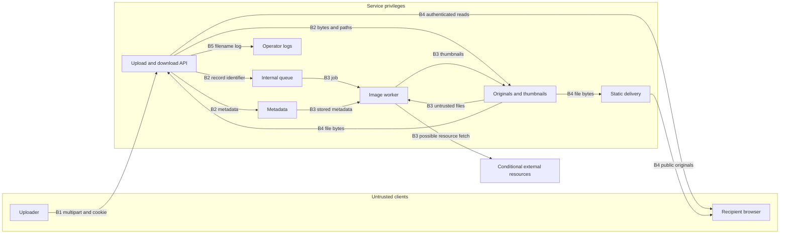

# File upload threat model — illustrative assessment

Date: 2026-10-07. Status: **real feature not assessed; launch sign-off pending evidence.**

## Executive summary

The supplied folder contained no application source, manifests, infrastructure configuration, tests, or handoff documents; it was not a usable Git repository. At your request, this assessment uses newly created, explicitly synthetic inputs. **None of the findings below establish a vulnerability or mitigation in your actual codebase.** In the sample, attacker-controlled filenames select writable paths, ownership is recorded but not enforced on reads, and originals become publicly accessible before validation or processing. Those would block a private, multi-user upload launch. File type spoofing, browser execution, resource exhaustion, and unsafe processing are additional gates. The immediate real launch blocker is the missing implementation and deployment evidence, rather than a demonstrated exploit.

## Scope and assumptions

In scope: upload acceptance, original and thumbnail downloads, filesystem storage, metadata, queued image processing, static delivery, and upload logging in [upload-flow.sample.txt](/tmp/loadout-outcome-work-vopwAj/sample-inputs/upload-flow.sample.txt:1). It is **inert pseudocode**, not a runnable application or proposed implementation. Helper behavior is explicitly defined at lines 5–20. The accompanying [deployment assumptions](/tmp/loadout-outcome-work-vopwAj/sample-inputs/deployment.sample.json:1) and [15 inert request cases](/tmp/loadout-outcome-work-vopwAj/sample-inputs/requests.sample.json:1) are also invented inputs. There are no verified production controls; “existing controls” below means controls in this sample only.

Assumptions used for ranking:

- HTTPS Internet exposure, authenticated uploaders, and potentially attacker-controlled accounts ([deployment:4](/tmp/loadout-outcome-work-vopwAj/sample-inputs/deployment.sample.json:4)). Anonymous upload is not assumed.
- Uploads may contain personal data and should be private to their owner unless explicitly shared ([deployment:6](/tmp/loadout-outcome-work-vopwAj/sample-inputs/deployment.sample.json:6)). Deliberately public media would change disclosure priorities, but not cross-owner writes or parser safety.
- Linux local storage is shared by the API, worker, and static server; originals use the application origin ([deployment:8](/tmp/loadout-outcome-work-vopwAj/sample-inputs/deployment.sample.json:8)). Object storage, signed URLs, bucket policies, and a CDN are **not discovered components**.
- Cookie authentication is modeled; SameSite settings, upstream CSRF protection, resource limits, filesystem privileges, and worker egress are unknown ([deployment:11](/tmp/loadout-outcome-work-vopwAj/sample-inputs/deployment.sample.json:11)). These can materially reduce or increase risk.

Your test instruction to create samples and carry on takes the place of an assumption-confirmation pause. Before applying this to production, resolve: (1) which file types and upload roles are actually needed, and whether files are private/shared/public; (2) the real storage, delivery origins, gateway limits, and access policies; (3) actual parsers, scanner, dependency versions, worker privileges, and network access.

Out of scope: unrelated application features, compromised administrators, local privilege escalation, CI/build execution, and dependency vulnerability findings without a manifest/lockfile. No real HTTP requests, malware, large allocations, image decoding, XML resolution, or archive extraction were performed. No existing application code was changed. The optional audit-context-building workflow was not applied because no actual codebase was supplied.

## System model

### Primary components

All components here describe the **sample**, not production:

- Upload API authenticates a cookie, checks only client MIME membership, buffers the complete stream, writes an owner-prefixed filename, inserts metadata, and queues work ([flow:28](/tmp/loadout-outcome-work-vopwAj/sample-inputs/upload-flow.sample.txt:28)). Original filenames, MIME, and bytes are untrusted; `user.id` comes from verified authentication.
- Metadata stores owner, path, filename, and client MIME with increasing integer IDs. Downloads look up an ID without owner scoping ([flow:12](/tmp/loadout-outcome-work-vopwAj/sample-inputs/upload-flow.sample.txt:12), [flow:41](/tmp/loadout-outcome-work-vopwAj/sample-inputs/upload-flow.sample.txt:41)). No framework, database product, or build system is specified.
- Worker decodes PNG/JPEG and renders SVG to JPEG thumbnails. Decoder versions, limits, and SVG external-resource settings are unspecified. PDF/ZIP originals are not parsed or extracted ([flow:53](/tmp/loadout-outcome-work-vopwAj/sample-inputs/upload-flow.sample.txt:53)). There is no scanning/quarantine state ([flow:71](/tmp/loadout-outcome-work-vopwAj/sample-inputs/upload-flow.sample.txt:71)). Making a thumbnail does not sanitize the original.
- Static server exposes originals without authentication, confines reads to the upload root, disables directory listing, guesses type from extension, and serves inline ([flow:64](/tmp/loadout-outcome-work-vopwAj/sample-inputs/upload-flow.sample.txt:64)). Its containment does not protect the separate upload write path.

### Data flows and trust boundaries

- **B1: Browser → API.** HTTPS multipart upload carries a session cookie, filename, client MIME, and arbitrary bytes. Cookie verification is modeled; TLS is assumed. Only MIME membership is validated. Multipart overhead/part counts, CSRF, byte limits, timeouts, and quotas are not established (TM-001/006/010).
- **B2: API → metadata/storage/queue.** Internal database, filesystem, and queue operations cross into service privileges. Owner identity is trusted, but the storage path and metadata include untrusted input. Storage IAM, encryption at rest, and filesystem separation are unknown. Internal jobs use server record IDs; this does not make file content trusted (TM-002/003/007).
- **B3: Storage/queue → worker.** Queued IDs cause local file reads and image parsing. No content approval state or explicit processing budgets are modeled. SVG rendering might introduce a worker → external/internal network or filesystem edge; this is conditional on the real renderer (TM-006/008).
- **B4: Storage → downloader/browser.** API originals and thumbnails require authentication but not ownership checks. A second HTTP static path requires neither. Originals are inline; same-origin browser trust and downstream viewers are exposed. Cache policy and delivery limits are unknown (TM-004/005/007/009).
- **B5: Upload API → logs/operator.** Untrusted filename enters a string log without structured actor/object/outcome fields. Log access and retention are unknown (TM-011).

#### Diagram

## Assets and security objectives

| Asset | Why it matters | Security objective |
|---|---|---|
| Originals and derived images | Personal data and owner-controlled content | Confidentiality, integrity |
| Metadata, ownership, publication state | Determines who receives which bytes | Integrity, confidentiality |
| Browser session and application authority | Active content could perform authenticated actions | Confidentiality, integrity |
| Server files and service credentials | Escaped writes or unsafe parsing can extend compromise | Integrity, confidentiality |
| API/worker memory, CPU, disk, queue and bandwidth | Upload/processing/download abuse can stop service | Availability |
| Audit records | Attribute uploads and investigate exposure or tampering | Integrity, availability |

## Attacker model

### Capabilities

An ordinary signed-in attacker controls filename, claimed MIME, multipart bytes, timing, concurrency, and requested IDs; can upload repeated names; and can send a recipient a file link. An anonymous attacker can request public static URLs. A hostile website may submit a cookie-bearing multipart request if browser/session policy permits it. File contents can target reachable parsers and client viewers.

### Non-capabilities

No assumed ability to forge a verified identity, modify deployment configuration, directly edit metadata/queues, create server symlinks, access arbitrary server paths without a vulnerability, or exploit a specific decoder CVE. Browser execution requires an active serving context; SVG loaded solely as an image is not assumed to execute script. SSRF, XXE, arbitrary read, and RCE are not confirmed by the mere existence of image processing.

## Entry points and attack surfaces

| Surface | How reached | Boundary | Notes | Sample evidence |
|---|---|---|---|---|
| Upload | `POST /api/uploads` | B1/B2/B5 | Authenticated; filename/MIME/bytes/log input | [flow:28](/tmp/loadout-outcome-work-vopwAj/sample-inputs/upload-flow.sample.txt:28) |
| Original download | `GET /api/uploads/{id}` | B4 | Authenticated, no owner-scoped query | [flow:41](/tmp/loadout-outcome-work-vopwAj/sample-inputs/upload-flow.sample.txt:41) |
| Thumbnail download | `GET /api/uploads/{id}/thumbnail` | B4 | Same authorization gap; JPEG output | [flow:47](/tmp/loadout-outcome-work-vopwAj/sample-inputs/upload-flow.sample.txt:47) |
| Static original | `GET /uploads/{path}` | B4 | Anonymous inline delivery, extension-based type | [flow:64](/tmp/loadout-outcome-work-vopwAj/sample-inputs/upload-flow.sample.txt:64) |
| Image job | Internal queue after upload | B2/B3 | PNG/JPEG decode and SVG render | [flow:53](/tmp/loadout-outcome-work-vopwAj/sample-inputs/upload-flow.sample.txt:53) |

There is no modeled delete, sharing, archive extraction, URL-import, or scan callback endpoint. Check these in the actual repository; do not infer their safety from this sample.

## Top abuse paths

1. **Cross-owner overwrite:** authenticate → submit `../tenant_b/report.pdf` with allowed MIME → filesystem normalizes the path → truncate another user's writable file. A new owner-tagged record does not authorize the underlying write.
2. **Private-file disclosure:** authenticate as B → enumerate integer IDs → fetch A's original or thumbnail. Alternatively, request a known public storage URL without any session.
3. **Stored browser execution:** label HTML bytes `image/png`, name them `report.html` → MIME membership accepts → static server returns HTML inline → victim opens same-origin link. Direct SVG document navigation is another active-content path; mere image embedding is not the assumed exploit.
4. **Service exhaustion:** send repeated large or slow streams → unbounded buffering/disk usage; submit small compressed images with huge decoded dimensions → worker resource exhaustion. Repeated public downloads consume bandwidth.
5. **Malicious attachment delivery:** upload PDF/ZIP → original is available before any content approval → recipient opens harmful content. A later successful thumbnail job is irrelevant to original safety.
6. **Conditional worker pivot:** upload SVG with external resources/entities → unsafe renderer fetches a private URL or reads a local file → thumbnail/output or timing discloses data. Actual renderer behavior must be established first.
7. **Victim-account abuse:** hostile site submits multipart with the victim's cookie → upload is attributed to the victim if no CSRF control applies → storage consumption or unwanted content.
8. **Evidence tampering:** filename includes a newline → unstructured log appears to contain additional events → missing actor/object fields impede investigation.

## Threat model table

STRIDE: S = spoofing, T = tampering, R = repudiation, I = information disclosure, D = denial of service, E = elevation of privilege. Ratings are **conditional sample estimates**, not measured exploit rates or production findings. No mitigation status below is known for the real application.

| Threat ID / STRIDE | Threat source | Prerequisites | Threat action | Impact | Impacted assets | Existing controls (sample evidence) | Gaps | Recommended mitigations | Detection ideas | Likelihood | Impact severity | Priority |
|---|---|---|---|---|---|---|---|---|---|---|---|---|
| TM-001 / T — type spoofing | Signed-in uploader | Arbitrary bytes and metadata | Claim PNG for malformed or active content; use mismatched/double extension | Unexpected content reaches storage, viewers and parsers | Files, browsers, worker | **Partial:** MIME allowlist [flow:25](/tmp/loadout-outcome-work-vopwAj/sample-inputs/upload-flow.sample.txt:25), [flow:31](/tmp/loadout-outcome-work-vopwAj/sample-inputs/upload-flow.sample.txt:31) | Client MIME is trusted; no extension/content validation | Approve minimal format set; enforce normalized extension, detected type and successful bounded decoding; reject mismatches; store generated canonical extension. Signatures alone are insufficient | Count type mismatches and decode failures by actor | **High:** metadata bypass is trivial | **High:** enables active content or harmful parsing | **high** |
| TM-002 / T,E — path traversal | Signed-in uploader | Writable target; controllable filename | Use dot segments or absolute filename to escape owner/root | Unauthorized file writes; wider compromise only if target is security sensitive | Server files, other owners' files | **Not mitigated:** trusted owner prefix [flow:33](/tmp/loadout-outcome-work-vopwAj/sample-inputs/upload-flow.sample.txt:33), but joining permits escape [flow:9](/tmp/loadout-outcome-work-vopwAj/sample-inputs/upload-flow.sample.txt:9) | No containment or symlink-safe writes | Use server-generated keys, never filename as path; confine writes with directory-relative, symlink-safe operations and restrictive service permissions | Rejected path components; unexpected writes outside storage | **High:** attacker directly selects path | **High:** cross-owner integrity; RCE not established | **high** |
| TM-003 / T — overwrite and mutable job input | Signed-in uploader | Repeated filename; cross-owner case also needs TM-002 | Truncate an existing path; queued jobs/old records read new bytes | Existing content changes; thumbnails no longer match original version | Files, metadata, jobs | **Partial:** owner prefix; **no collision protection:** truncation [flow:11](/tmp/loadout-outcome-work-vopwAj/sample-inputs/upload-flow.sample.txt:11), worker rereads path [flow:54](/tmp/loadout-outcome-work-vopwAj/sample-inputs/upload-flow.sample.txt:54) | IDs do not make file paths unique or immutable | Unique storage key plus atomic create-if-absent; pin job to immutable version/hash; replacement requires explicit owner authorization; publish only matching approved bytes | Collision/version mismatch events | **High:** repeat names require little effort | **High:** cross-owner loss with traversal; otherwise own-content corruption | **high** |
| TM-004 / I — IDOR | Signed-in downloader | Another valid integer ID | Request another owner's original or thumbnail | Cross-user private-file disclosure | Originals, derivatives, ownership | **Partial:** authentication [flow:42](/tmp/loadout-outcome-work-vopwAj/sample-inputs/upload-flow.sample.txt:42), [flow:48](/tmp/loadout-outcome-work-vopwAj/sample-inputs/upload-flow.sample.txt:48); unscoped lookups at 43/49 | Retrieved owner is never compared to requester | Owner/tenant-scoped authorization on both routes and future delete/share/status/signed-URL issuance; deny before opening bytes; non-disclosing errors. Opaque IDs are only defense in depth | Cross-owner denials and enumeration rates | **High:** IDs are enumerable | **High:** personal data crosses tenants | **high** |
| TM-005 / T,E — stored XSS | Uploader targeting recipient | Active document opened inline on app origin | Upload spoofed HTML or SVG; send original URL | Execute browser script with application-origin authority | Browser session, account actions | **Not mitigated:** inline API [flow:45](/tmp/loadout-outcome-work-vopwAj/sample-inputs/upload-flow.sample.txt:45), static type/headers [flow:67](/tmp/loadout-outcome-work-vopwAj/sample-inputs/upload-flow.sample.txt:67) | Same origin; raw active content; originals remain after rendering | Reject unneeded active formats; preview only validated raster output. For necessary originals, force attachment with safe encoded filename, trusted MIME and `nosniff`; use a separate origin receiving no application cookies and restrictive CSP | Active-type uploads and unexpected response types/headers | **High:** simple upload plus victim navigation | **High:** authenticated actions/data; HttpOnly would not stop those actions | **high** |
| TM-006 / D — resource and decompression abuse | Uploader or public downloader | Network access; worker accepts crafted images | Huge/slow uploads, repeated jobs, huge decoded images/frames, high-volume downloads | Memory/CPU/disk/queue/bandwidth exhaustion | Service availability | **Not established:** all-byte buffering [flow:8](/tmp/loadout-outcome-work-vopwAj/sample-inputs/upload-flow.sample.txt:8), processing [flow:16](/tmp/loadout-outcome-work-vopwAj/sample-inputs/upload-flow.sample.txt:16); **archive extraction absent** [flow:61](/tmp/loadout-outcome-work-vopwAj/sample-inputs/upload-flow.sample.txt:61) | Gateway/decoder defaults unknown; no explicit application budgets | Bound actual streamed bytes including chunked requests; bound multipart counts, deadlines, concurrency, account/global storage and bandwidth. Worker: pixel/frame/output/memory/CPU/time limits and capped queue. If archives are ever extracted, bound expansion/nesting/member counts and confine member paths | Request rejections, quota usage, queue age, worker timeouts, disk and egress alarms | **High:** bulk abuse easy; image bomb depends on decoder defaults | **High:** shared service outage or cost spike | **high** |
| TM-007 / T — malware and premature publication | Uploader targeting recipient | Raw attachments can be downloaded/opened | Publish harmful PDF/ZIP or other mislabeled content before checks | Recipient compromise and harmful-file hosting | Recipient systems, reputation, file integrity | **Not mitigated:** write precedes work [flow:34](/tmp/loadout-outcome-work-vopwAj/sample-inputs/upload-flow.sample.txt:34); no scan/quarantine [flow:71](/tmp/loadout-outcome-work-vopwAj/sample-inputs/upload-flow.sample.txt:71) | No pending/clean/rejected state; scanner outages cannot gate access | Private immutable quarantine; scan approved attachment types with approved scanner, signatures and timeouts; release only on clean outcome, fail closed on errors, enforce state on every read path. Consider content reconstruction for needed documents; scanning is not a safety guarantee | Scan result/error/age, access denied while pending, reject spikes | **Medium:** delivery easy; compromise needs malicious content and viewer behavior | **High:** recipient compromise is possible, not proven | **high** |
| TM-008 / I,E — conditional SSRF/XXE/parser exploit | Crafted-image uploader | Renderer resolves resources/entities or decoder has exploitable defect | SVG fetches internal URL/entity reads file; crafted bytes exploit decoder | Internal-data disclosure; possible worker compromise | Service credentials, internal data, compute | **Unknown:** SVG renderer [flow:18](/tmp/loadout-outcome-work-vopwAj/sample-inputs/upload-flow.sample.txt:18), [flow:59](/tmp/loadout-outcome-work-vopwAj/sample-inputs/upload-flow.sample.txt:59); no PDF/ZIP parsing | No actual implementation/version/egress evidence | Reject SVG if unnecessary; otherwise disable DTD, entities, external resource/delegate execution and network fetches in the actual parser. Sandbox worker with no secrets, minimal files, restricted formats, no network by default, resource limits, and patched pinned dependencies | Unexpected worker DNS/egress/local-file reads; parser failures | **Low:** provisional; required behavior unverified | **High:** sensitive reads or compromise if reachable | **medium**; promote to **high** if unsafe reachable behavior confirmed |
| TM-009 / I — public storage bypass | Anonymous downloader | Knows or obtains a file URL | Bypass API auth via static original URL | Private-file exposure independent of IDOR fix | Originals, personal data | **Partial:** root confinement/no listing [flow:66](/tmp/loadout-outcome-work-vopwAj/sample-inputs/upload-flow.sample.txt:66); **public read** [flow:65](/tmp/loadout-outcome-work-vopwAj/sample-inputs/upload-flow.sample.txt:65) | Privacy policy conflicts with static exposure | Remove public alias for private files; authorize reads through service. If actual storage is a bucket/CDN, verify private policies, restricted origin, short-lived scoped URLs, cache isolation and purge/revocation behavior; do not assume obscurity provides auth | Anonymous direct-read probes; policy drift; cache exposure | **High:** public path intentionally serves bytes | **High:** sensitive files become public | **high** |
| TM-010 / S,T — CSRF | Hostile website | Browser sends session cookie cross-site; no upstream CSRF control | Submit an upload as victim | Unwanted files, quota consumption and misleading attribution | Account state, quota | **Partial:** cookie verification [flow:6](/tmp/loadout-outcome-work-vopwAj/sample-inputs/upload-flow.sample.txt:6); no sample CSRF check [flow:72](/tmp/loadout-outcome-work-vopwAj/sample-inputs/upload-flow.sample.txt:72) | Cookie/Origin policy unknown; authentication alone insufficient | Enforce framework CSRF tokens or approved equivalent with Origin checks and appropriate SameSite policy on cookie-authenticated mutations; test multipart forms. Reassess if credentials are explicitly supplied bearer tokens | CSRF/Origin denials without logging tokens | **Medium:** depends on browser/middleware policy | **Medium:** upload state abuse, no assumed read access | **medium** |
| TM-011 / R,T — audit gaps/log injection | Signed-in uploader | Untrusted filename reaches log | Newline forges log appearance; deny responsibility | Poor incident attribution and tamper detection | Audit evidence | **Partial:** one string log [flow:20](/tmp/loadout-outcome-work-vopwAj/sample-inputs/upload-flow.sample.txt:20), [flow:38](/tmp/loadout-outcome-work-vopwAj/sample-inputs/upload-flow.sample.txt:38) | No actor/object/result/request correlation; encoding unspecified | Structured events with trusted actor/tenant, object ID/version, validation/scan outcome and request ID; encode untrusted fields; restrict access/retention; omit bytes, cookies and signed URLs | Failed validation/access spikes; audit continuity checks | **Medium:** filename manipulation easy | **Medium:** response/detection impairment; no direct breach by itself | **medium** |

## Criticality calibration

Ratings combine likelihood, affected asset, reach, and demonstrated controls. Authentication reduces pre-auth reach but does not protect against malicious users. Private multi-tenancy and same-origin delivery drive the high disclosure/XSS ratings; renderer capabilities and privileges drive conditional escalation.

| Level | Meaning in this model | Examples |
|---|---|---|
| critical | Confirmed broadly reachable takeover or bulk sensitive exfiltration | Proven unauthenticated decoder RCE; proven arbitrary write into executable service configuration with takeover. Neither is established here |
| high | Straightforward serious privacy/integrity/availability compromise, or harmful attachment delivery | Cross-owner original/thumbnail reads; writable-path escape; stored active content with application authority |
| medium | Conditional severe path without required behavior established, or narrower harm | Unverified SVG external resolution; cookie-dependent upload CSRF; audit evidence spoofing |
| low | Narrow, low-sensitivity consequence with effective containment | Disclosure of a deliberately public image's dimensions; harmless invalid-type error without internal details. These are examples, not additional findings |

## Focus paths for security review

These are reviewable **sample paths**, not claimed production paths. Replace them with actual route handlers, callers, auth helpers, storage adapters, image workers, response/header config, manifests/lockfiles, and infrastructure policies in the real review.

| Path / symbol | Why it matters | Related threats |
|---|---|---|
| [upload-flow.sample.txt — `upload`, helper contracts](/tmp/loadout-outcome-work-vopwAj/sample-inputs/upload-flow.sample.txt:5) | Verify validation order, streaming, path invariants, collisions, state transitions and logs | TM-001/002/003/006/007/010/011 |
| [upload-flow.sample.txt — `download`, `thumbnail`](/tmp/loadout-outcome-work-vopwAj/sample-inputs/upload-flow.sample.txt:41) | Enforce owner and approval state before all original/derived reads | TM-004/005/007 |
| [upload-flow.sample.txt — `process`, static delivery](/tmp/loadout-outcome-work-vopwAj/sample-inputs/upload-flow.sample.txt:53) | Trace parser privileges and every bypass of approved delivery | TM-005/006/008/009 |
| [deployment.sample.json](/tmp/loadout-outcome-work-vopwAj/sample-inputs/deployment.sample.json:1) | Replace privacy, origin, limits and privileges assumptions with deployment evidence | TM-004/005/006/008/009/010 |
| [requests.sample.json](/tmp/loadout-outcome-work-vopwAj/sample-inputs/requests.sample.json:4) | Seed safe negative tests; outcomes are expected secure behavior, not observed results | All |

## Prioritized launch blockers and follow-ups

**Actual launch gate:** obtain and review the real source and deployed configuration, including authentication/authorization callers, tests, storage policies, processing dependencies, and response behavior. This report alone cannot support production approval. The ordered gates below apply **if the sample behavior exists in production**; none is a confirmed production defect.

1. **Block — prevent unauthorized writes and overwrites (TM-002/003).** Require generated immutable storage keys, atomic collision handling, containment, and least privilege. Exit evidence: traversal/absolute-path/repeated-name tests cannot change another object or any out-of-root marker; queued processing is bound to the approved version.
2. **Block — close every private-read path (TM-004/009).** Scope original/thumbnail authorization and remove anonymous storage delivery. Exit evidence: user B and anonymous callers cannot read A's originals/derivatives through API, static paths, actual bucket/CDN, or caches; approved sharing is explicitly tested.
3. **Block — validate types and isolate browser delivery (TM-001/005).** Reject mismatches and unnecessary active formats; preview only safe output; establish safe original delivery. Exit evidence: spoofed HTML/SVG never becomes an active application-origin document, and response headers match the approved format policy.
4. **Block — bound upload, processing and download resources (TM-006).** Set product-approved finite budgets and enforce actual bytes, decoded image cost, time, concurrency, quotas and bandwidth. Exit evidence: controlled just-over-limit tests fail without worker/service exhaustion or unbounded temporary files. Do not run real bombs against shared infrastructure.
5. **Block for downloadable attachments — gate publication on approval (TM-007).** Scanner/content-policy decisions must precede every read path. Exit evidence: pending, rejected, timeout/error and changed-version objects remain inaccessible. If launch is restricted to generated raster previews with no original download, reassess this gate explicitly.
6. **Block evidence gap — establish processing behavior and containment (TM-008).** Identify exact renderer/decoder/native dependencies and prove external-resource restrictions and worker isolation. Exploitation is unconfirmed; shipping an unexplored parser is the unresolved gate. If SVG is excluded and a bounded raster-only path is demonstrated, document the reduced scope.
7. **Conditional block — cookie upload CSRF (TM-010).** Verify effective middleware/session behavior; fix if cookie-bearing cross-site multipart requests mutate state. An existing verified upstream control can close this gate without an application change.

**Follow-ups after the relevant gates close:** structured audit/alerting improvements (TM-011); expiry/retention/deletion and orphan cleanup across metadata, files, thumbnails and caches; abuse reporting/takedown for intentionally public files; periodic policy-drift/dependency review and quota tuning. Cleanup becomes a blocker if failed uploads accumulate without any storage cap. If sensitive metadata such as image location is retained, approve that data policy or strip it before publication.

**Small fix candidates to mention, not apply:** the modeled private-owner policy makes owner-scoped queries at `download`/`thumbnail` a straightforward first patch candidate; restricting unneeded active MIME types is another containment step after the product format policy is confirmed. Neither closes static bypass, content spoofing, or path writes on its own. No actual-code fix can be called “trivial and clearly safe” until its callers and contracts are available. No patches were applied.

## Pre-launch sign-off checklist

- [ ] Real source/configuration reviewed; sample assumptions replaced; findings linked to actual files/lines and build revision.
- [ ] Owner/tenant rules tested on every upload/read/derived/share/delete path that exists; anonymous storage and cache probes match intended privacy.
- [ ] Generated immutable keys; traversal, absolute paths, repeated names, and processing-version races cannot overwrite unauthorized files.
- [ ] Approved formats, content validation, safe original headers/origin, and preview policy tested with malformed, MIME/extension mismatch, and active-content cases.
- [ ] Actual-stream, multipart, time, quota and concurrency limits plus decoded-image budgets tested; archives are not extracted or have separately verified expansion/member-path limits.
- [ ] Publication state enforced on every serving path; scan/processing errors and timeouts fail closed where approval is required.
- [ ] Parser/dependency versions reviewed; external entities/resources/delegates disabled where relevant; worker filesystem/secrets/network access constrained.
- [ ] Authentication/session/CSRF behavior, audit attribution, basic alarms, failed-upload cleanup and an upload-disable rollback exercised.

Sign-off: owner ______; reviewer ______; revision/environment ______; evidence links ______; accepted residual risks and expiry ______; date ______.

## Verification and handoff notes

Folder discovery used `rg --files --hidden --no-ignore .` and `ls -la`: no supplied files were found. `git status --short --branch` failed because the folder is not a repository; no branch, commit, merge, or other-model branch review was possible. `rtk` was unavailable. Python 3.14.4 was available.

Artifact checks, exact commands and results are recorded in [VERIFICATION.md](/tmp/loadout-outcome-work-vopwAj/VERIFICATION.md). These checks validate JSON parsing, report structure, line references and request/threat coverage only. **No upload runtime tests, build, scanner checks, browser tests, or production policy probes could run without an implementation.** Request cases are inert test inputs, not exploit confirmations; large-file/bomb cases are descriptors rather than allocated files.

Handoff: map the sample `upload(request)`, `download(request, id)`, `thumbnail(request, id)`, `process(job)` and static delivery to actual handlers and callers. Recheck helper contracts before transferring any finding. In particular, distinguish original/derived access, API/static/cache authorization, immutable stored bytes versus job-time rereads, and parser defaults versus explicit settings. Attach real configuration and run safe isolated tests before changing the launch verdict.

Quality check: all five modeled entry surfaces and B1–B5 are covered; runtime sample behavior is separated from development artifacts; conditional SVG and absent archive/PDF processing are explicit; assumptions remain unconfirmed under the authorized empty-folder test; every threat has likelihood, impact, sample-control evidence, a fix and detection idea. No confirmed RCE or actual-repository control is claimed.

## Guidance consulted

These references support recommended control patterns, **not evidence about the application**. MIME and signature checks need layered validation; generated storage names, separate storage, bounded processing, and controlled delivery form complementary defenses. Antivirus does not replace format validation or authorization. See [OWASP File Upload Cheat Sheet](https://cheatsheetseries.owasp.org/cheatsheets/File_Upload_Cheat_Sheet.html).

The conditional XML recommendation is to disable DTD/external entity resolution in the actual parser rather than assume safe defaults. See [OWASP XXE Prevention Cheat Sheet](https://cheatsheetseries.owasp.org/cheatsheets/XML_External_Entity_Prevention_Cheat_Sheet.html). Cookie-authenticated mutations require an effective CSRF defense; SameSite is generally an additional layer. See [OWASP CSRF Prevention Cheat Sheet](https://cheatsheetseries.owasp.org/cheatsheets/Cross-Site_Request_Forgery_Prevention_Cheat_Sheet.html).
