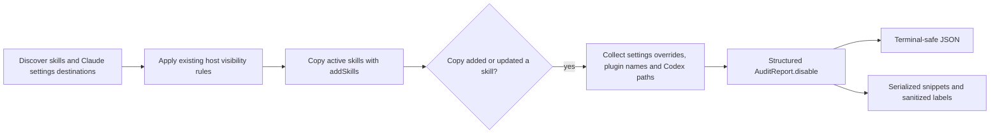

# A6: adoption hide snippets

Scope: implement the supplied A6 acceptance criteria on
`agent/a6-adopt-hide-snippets`, based on `eda54dd`. Local commits only; no
host-config writes, network/model calls, new dependencies or commands.



Implementation (completed):
- Added fixture tests to `test/audit.test.ts` and confirmed failures against the
  existing generic advice.
- Retained Claude settings destinations in `src/audit.ts`; build instructions
  only for successful copies with active native listings. Use the existing
  override and disabled-skill knowledge. Serialize exact names and paths,
  escaping terminal controls without changing configuration values.
- Used the same structured instructions in CLI JSON and human output. Updated
  `docs/library.md#skills`, the README link, and only A6 in the backlog.
- Ran typecheck, all tests, a manual fixture-home CLI adoption, and diff scans.

Key symbols: `FoundSkill.claudeSettings` retains discovery destinations;
`audit(cwd, adopt)` collects `AuditReport.disable` only after `addSkills`
reports an added or updated copy. `formatAuditJson(value: object)` serves
CLI JSON and Claude snippets; `formatAudit(report)` uses smol-toml for Codex
and `clean` for destination labels. `escapeControls` preserves exact values
with Unicode escapes, including TOML's astral `\U` form. Tests parse the
printed snippets back into objects and compare them to the original inputs.

Project mapping: a skill discovered under a directory's `.claude/skills`
targets that directory's `.claude/settings.local.json`. User skills target
the effective Claude home's `settings.json`. Host-home overrides are respected.
Claude overrides match names, so same-named skills cannot be hidden separately
within one effective settings scope. Plugin instructions disable whole plugins.

Verification (Windows, Node 24.16.0, 2026-10-28):

```text
rtk npm ci
added 173 packages, and audited 174 packages in 24s
found 0 vulnerabilities

rtk npm run typecheck
> tsc --noEmit
exit 0

rtk npm test -- test/audit.test.ts
Test Files  1 passed (1)
Tests  44 passed (44)

rtk npm test
Test Files  33 passed | 4 skipped (37)
Tests  1112 passed | 115 skipped (1227)
Duration  51.86s

rtk git diff --check
exit 0 (no output)

UTF-8 mojibake/local-absolute-path scan of additions and this handoff
Mojibake/local-path scan: 0 findings
```

Red/green evidence: before implementation the audit suite had 7 failures
(the new structured output was absent), with 36 existing tests passing. The
first implementation run had 42 passes and one obsolete assertion expecting
the generic word `disable`; it now checks `user-invocable-only`. A temporary
`node -e` serializer probe failed because Windows PowerShell removed argument
quotes; the same probe passed via stdin. No product failure was concealed.

Manual command: `npx --no-install --prefix <worktree> tsx <worktree>/src/cli.ts
audit --adopt`, with cwd inside a temporary fixture repo. `HOME`, `USERPROFILE`,
`LOADOUT_HOME`, `CLAUDE_CONFIG_DIR`, `CODEX_HOME` and `XDG_CONFIG_HOME` were set
to fixture directories and restored afterwards. The output showed user
`writing` and project `repo-review` JSON overrides, plugin `tools`, and one
Codex entry for `checks`; `already-off` was omitted from Codex instructions
even though OpenCode/Cursor still discovered it. Actual summary:

```text
Adopted: 5 added, 0 updated, 0 skipped.
Printed only; no host configs were changed.
Manual audit exit: 0
```

No Jev, agent CLI/model, benchmark, or paid service calls were made: $0.
The official host docs linked from `docs/library.md` were checked. No live
host config was changed, and Linux/macOS checks were not run.

Independent review is pending: no commit has received the Claude
`pr-reviewer` or fresh Codex adversarial pass. Leave those gates to the parent
coordinator within its authorized budget. No push, PR, or merge was attempted.
The backlog row remains `in progress` as requested. No implementation work
remains against the supplied acceptance criteria.
