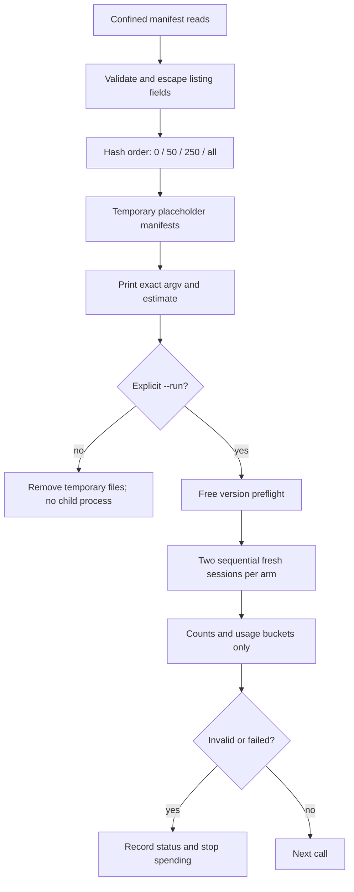

# B12 listing remeasurement harness

Implementation starts at `eda54dd`. Paid measurement and results are pending.
Budget used by this implementation: $0; no Jev or model invocations.

## Design and implementation plan

Use a separate `bench/listing.ts`, importing B1's `claudeIsolation`,
`parseClaudeTurns`, `parseCodex` and `assertTemporary`. B1 retains its original
pack arms and output contract. Extending it would mix that historical study
with B12's size arms, explicit run gate and counts-only privacy contract.
B7 already provides `childEnv` and `claudeEnv`; reuse their allowlist and
subprocess credential scrubbing without duplicating environment policy.
No dependency or production behavior changes.



Implementation sequence: add adversarial writer, argv and parser tests;
observe the missing-module failure; implement the harness; add driver tests;
run typecheck, tests and free plans; scan the diff; commit locally.

A free PowerShell argv check showed that embedded JSON quotes are stripped
by its native argument passing. Command input therefore takes an executable
path and repeatable `--claude-arg`/`--codex-arg` prefix arguments, not JSON
text. The printed argv remains JSON for unambiguous review.

## Entry points and contracts

- `readListingLibrary(library)` reads only `skills/*/SKILL.md` with
  `readConfined`, rejects invalid/linked entries, normalizes names to the
  common host grammar, deduplicates, and sorts by SHA-256 of the name.
  Counts of rejected and normalized entries and a corpus hash are recorded.
- `writeProbeSkills(skills, destination)` accepts temporary destinations
  only. It writes escaped name/description scalars and a fixed third-party
  placeholder. No other frontmatter, body or supporting file survives.
- `buildListingPlan(corpus, root, options)` prepares exact literal argv.
  It requires at least 250 distinct valid manifests. Claude has four size
  arms and two default-tools arms; Codex has four size arms. Each has two
  fresh, sequential calls. The MCP arm uses the full sanitized library and
  a temporary `LOADOUT_HOME`, lexical search and no key.
- `parseListingUsage(host, stdout)` exposes numeric usage and counts only.
  Claude uses per-request assistant counters, not potentially cumulative
  result totals. Codex uses completed-turn totals. Tool use invalidates a
  measurement. Codex initial-list visibility and resolved model are unknown;
  the configured model and version preflight are recorded separately.
- `main(args)` defaults to plan mode. `--run` requires a new `--out`
  directory; failures produce a sanitized invalid row and stop subsequent
  paid calls. No transcripts, context, raw errors or ambient plugin names
  are persisted. Plans print argv (including the fixed probe prompt), not
  environment values. Temporary files are removed on exit.

## Platform and live-run limits

Run the Claude arm from native Windows Node with the native executable;
run Codex from WSL Node with a WSL library and command. Do not put a WSL
wrapper around a host while generating paths in Windows: a command prefix
does not translate cwd, plugin, loader or MCP paths. `--host` makes these
two independent runs. See [commands](../../bench/README.md#b12-native-listing-remeasurement).

Use a deliberately selected public library and a clean, already authenticated
benchmark `CODEX_HOME`. No credential is copied by this harness. The selected
home must have no `.env`, user skills, hooks or alternate provider setup.
The exec overrides skip user config/rules; they do not isolate every system
or managed configuration layer. Claude retains its logged-in ambient home
as B1 did; counts report ambient plugins but cannot establish identical plugin
contents. Hosts may write auth refreshes, caches and diagnostics under their
normal homes. The harness does not edit their configuration files.

Free help/version checks on 2026-10-28 found Claude Code 2.1.308 and Codex
0.163.0. Codex exec help advertises `--ignore-user-config`, `--ignore-rules`,
`--ephemeral`, `--json`, `--skip-git-repo-check`, `--config` and `--disable`.
Claude help advertises the plugin, tools, settings, MCP and persistence flags,
but not B1's `--restricted`; its acceptance and isolation effect remain
unverified by this committed harness until an authorized live run.
Neither host was invoked with a prompt during implementation.

The pilot's Codex `debug prompt-input` command failed, so this harness does
not use it or claim initial-list visibility. Claude init counts discovery;
it does not expose which descriptions reached the model. A plateau alone
does not prove a host budget caused it. The second call is a second fresh
session, not a guaranteed cache hit. Other arms can share cache prefixes.

## Review and remaining work

Implementation commit: `9eef40983bebf12184d194de114a453975676944`.
Its tree is `d978c489425d5cc1bc20fa732125882fd840e07a`. The WSL clone
tested that identical tree before a local author-metadata correction;
`git rev-parse` confirmed both tree IDs match. No independent review has run.

Verification (2026-10-28, all free):

```text
Windows npm ci:
added 173 packages, and audited 174 packages in 27s
found 0 vulnerabilities

npm run typecheck (Windows and WSL): tsc --noEmit, exit 0

Windows npm test:
Test Files  34 passed | 4 skipped (38)
Tests       1113 passed | 116 skipped (1229)

WSL npm test (Git checkout outside /tmp):
Test Files  38 passed (38)
Tests       1180 passed | 50 skipped (1230)

WSL npx vitest run test/listing.test.ts:
Test Files  1 passed (1)
Tests       9 passed (9)

Claude --plan: 12 paid calls planned; estimate $4.64
Codex --plan: 8 paid calls planned; estimate $3.83
Both: Plan only: no child processes started.
```

Plan estimates use the printed illustrative assumptions, not actual spending.
Commands were `node --import tsx bench/listing.ts --plan --host <host>
--library <selected-library> --<host>-command <native-executable>`, using
Windows Claude and WSL Codex respectively. The final plans accepted the same
corpus hash. No planned paid command was executed.

Three mutations in the disposable WSL checkout each failed their targeted
test: removing the plan gate, metadata escaping, and destination confinement.
Source was restored and all nine B12 tests passed afterward. Staged diff
checks passed; added lines contained no mojibake or personal absolute paths,
and all 114 local Markdown link targets existed.

An earlier WSL full-suite attempt in a file-only snapshot failed (69 failed,
1110 passed, 50 skipped): missing Git metadata, inherited CRLF shell files,
and a test requiring the repository to be outside the system temp directory.
The proper Git checkout fixed these setup issues without repository changes.
WSL npm ci reported three blocked optional/package install scripts; tests
and typecheck still passed. An initial PowerShell JSON-command plan failed
before starting any host; the executable/argument flags above fixed it.

Cross-model review and the repository's merge reviews remain pending: the
$0 cap prohibits starting additional paid Claude/Codex runs. No public
action or merge is authorized. The coordinator should review the local
commit, authorize and run the printed measurements, commit raw aggregate
rows, then write the B12 results and revisit the README headline. Pilot
numbers are deliberately absent from committed results.
