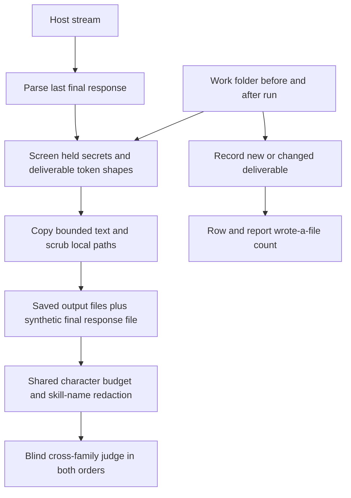

# C14 pilot implementation handoff

Scope: record the 2026-10-26 Codex Luna pilot without changing its artifacts,
repair the hidden-test focus shim, and include final responses in future judge
views. No paid runs, push or PR. The orchestrator owns review and the rerun.

Observation: the original hidden test crashes on correct Escape focus return.
Hypothesis (confirmed by both bare pilot outputs): its fake button lacks
`focus()`. The planted listener faults must continue to fail after repair.

Study settings must retain the same keys: model/effort, schedule options,
commit and library fingerprint. Changed code already changes provenance, so a
run from the repaired harness must use a fresh output directory.

Implementation:

- `bench/stream.ts`, `toolEvents(stream)`: adds optional `finalMessage`, the
  last completed Codex agent message or Claude result string. No reasoning or
  partial message is persisted as the final response.
- `bench/ab.ts`, `copyOutputs(work, dest, folders, secrets, finalMessage?,
  warmup = false)`: screens the response before any copy, applies the existing
  text/byte limits and path scrubbing, and chooses a collision-safe synthetic
  filename. Warm-ups persist only their final response. `judgeAll` already
  applies the shared character budget and skill-name redaction to this view.
- `execute1`: compares deliverable contents before/after execution to record
  `wroteFile`. Unchanged fixtures and the synthetic response cannot count.
  `bench/ab-report.ts` reports known file-write counts and leaves legacy rows
  unknown. No options, settings keys, host flags or runtime dependencies added.
- The hidden-test fake elements record focus in `doc.activeElement`. Existing
  assertions still accept fixes without focus return and reject the planted
  listener faults. Both bare and both loadout pilot outputs pass the repaired
  hidden test and their own tests under `node --test`.

Evidence: all three supplied findings were reproduced from the copied public
artifacts. The 29 files (52,394 bytes) are byte-identical to the authorized
source folder, without streams. Key/JWT/provider-token shapes, credential
assignments, local home paths and mojibake scans found no matches. The
original report and rows intentionally retain the defective measurements.

Verification gotchas and intermediate failures:

- The seven initial regressions failed before implementation, then passed.
  Typecheck also caught a test outside its fixture scope; it was moved inside.
- Direct WSL verification in the Windows-created worktree cannot resolve the
  Windows gitdir pointer. Use a disposable Linux checkout for the checks.
  A CRLF overlay without matching Git conversion also caused provenance
  `git diff` to exceed its output buffer (`ENOBUFS`). These are verification
  environment issues; no production workaround was added.
- Fourteen A/B credential tests initially assumed earlier warm-ups saved no
  outputs. Their assertions now preserve earlier safe final responses while
  requiring the stopped run to persist nothing.
- The first full suite had two CRLF shell-script failures:
  `test/bench.test.ts`, `answer-batches.sh answers only seeds and expand
  batches: seeds` and `: judge`. In the disposable checkout only, eight
  unchanged shell scripts were restored to their canonical Git blob LF bytes.
  Repository line endings and pilot bytes remain unchanged.
- `npm ci` reports four dependency advisories (two moderate, two high) and
  blocked optional install scripts; dependency remediation is outside C14.
- The original pilot Markdown contains twelve trailing double-space line
  breaks in `outputs/codex/c1-web-14/loadout-{1,2}/404-copy.md`. Preserve them;
  a default diff check against the base reports these existing artifact bytes.

Final verification (WSL Node 24.15.0, disposable Linux checkout of the same
source, canonical LF shell scripts):

- `npm ci`: exit 0; advisories and optional-script notices described above.
- `npm run typecheck`: exit 0.
- `npm test`: exit 0; 37 files passed, 1,171 tests passed, 50 skipped
  (1,221 total), 55.61 seconds. All 155 `test/ab.test.ts` cases passed.
- Fixes/docs `git diff --check`: clean. The preserved results' default
  `git diff --cached --check` returned 1 for the twelve Markdown hard breaks
  described above. The artifact index hashes match all 29 source files.
- Changed repository files retain CRLF. No mojibake patterns found in the
  changed files or pilot artifacts. No new external-model calls: $0 study cost.

Commits: `a603768` fixes; `c8e1aaa` unchanged pilot artifacts. Review the final
branch HEAD, including the documentation commit. The implementation sub-agent
ran no model review; the orchestrator owns both review gates and the fresh
Codex pilot rerun. No merge, push or PR was performed.
