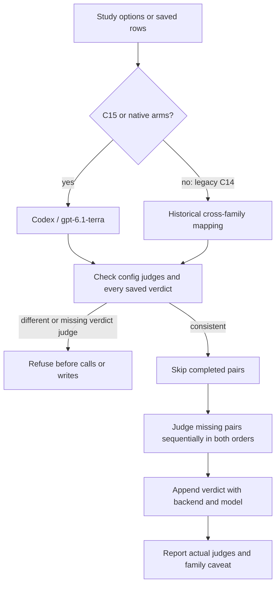

# C15 judge change, 2026-11-04

Erik selected Codex / gpt-6.1-terra to avoid Anthropic's five-hour limit
interrupting the study. This overrides the family-separation rule: Terra,
the Luna agent and the C1 Sol request writer share the OpenAI family.

`bench/ab.ts:judgesFor()` preserves the historical C14 mapping; `judgeAll()`
validates the saved config and every verdict before skipping completed pairs
or appending new ones. New configs include a `judges` map keyed by host.
Legacy C14 folders without that map retain Opus on Codex outputs. Missing or
conflicting verdict provenance refuses judging, including on skipped pairs.
`bench/ab-report.ts:reportNative()` reports actual saved provenance and the
OpenAI family caveat. No historical result file is changed.

## Isolation evidence and remaining blocker

Free probes on the installed WSL `/home/erikh/.local/bin/codex` reported
`codex-cli 0.163.0`. `codex exec --help` confirms `--ignore-user-config`,
`--ignore-rules`, `--ephemeral`, `--skip-git-repo-check`, `--sandbox read-only`,
`--output-schema` and `--output-last-message`. The existing backend uses these
flags with a neutral temporary cwd and stdin prompt. It retains the caller's
`CODEX_HOME` for authentication: in the planned study, `~/codex-bench-home`.
It does not create a clean authentication home or modify user configuration.

Tagged source, all at `rust-v0.163.0`:

- [Global instructions provider](https://github.com/openai/codex/blob/rust-v0.163.0/codex-rs/codex-home/src/instructions/mod.rs):
  `CODEX_HOME/AGENTS.md` and `AGENTS.override.md` remain independent of user
  config. The backend now refuses either, without reading its text, on every
  call. It no longer caches the free refusal check across calls.
- [Repository instructions](https://github.com/openai/codex/blob/rust-v0.163.0/codex-rs/core/src/agents_md.rs):
  `project_doc_max_bytes=0` skips repository AGENTS discovery.
- [Config](https://github.com/openai/codex/blob/rust-v0.163.0/codex-rs/core/src/config/mod.rs)
  and [skills extension](https://github.com/openai/codex/blob/rust-v0.163.0/codex-rs/ext/skills/src/extension.rs):
  `skills.include_instructions=false` suppresses the skill catalog. It does
  **not** establish isolation from explicit skill injection. Installed skill
  roots remain discoverable, including CODEX_HOME and HOME/.agents. No paid
  run tested that context. A future tool-less-capable CLI still needs this
  isolation verified or fixed before the study; do not treat catalog
  suppression as proof of full skill isolation.
- [Feature definitions](https://github.com/openai/codex/blob/rust-v0.163.0/codex-rs/features/src/lib.rs):
  the backend additionally disables hooks and plugins. The pre-existing
  shell, unified-exec and image flags remain in place.

The free command `codex -c features.shell_tool=false -c
features.unified_exec=false -c features.view_image=false features list`
reported `shell_tool=false`, `view_image=false`, **`unified_exec=true`**.
E12 therefore still blocks C15 before agent spending. Read-only is not
tool-less: shell reads could expose files, and execution is not safe to allow
on adversarial judge data. The refusal is retained. No judge executes tools
or writes deliverables because no judge model call is allowed on this install;
the harness may write its schema/answer files and Codex may update auth/cache
state when eventually usable. This task did not launch a real model, Jev
call, or the study.

## Verification and review disposition

Cost incurred: **$0**. No model/Jev call and no real study launch.

- `npm ci --no-audit --no-fund`: 174 packages installed. npm blocked install
  scripts for esbuild, onnxruntime-node and protobufjs under the machine's
  existing policy; no approval or policy change was made.
- `npm test -- --maxWorkers=4`: **40 files passed, 1,288 tests passed,
  50 skipped** (1,338 total).
- `npm run typecheck`: exit 0.
- `git diff --check`: exit 0. BOM check: 9 changed/new files, zero BOMs.

The full suite ran on a WSL-native verification snapshot outside `/tmp`.
The six changed implementation/test files were checked byte-for-byte against
this worktree. Initial runs exposed environment issues: Linux Git cannot read
this Windows worktree's `.git` pointer; a repository inside `/tmp` invalidates
the suite's outside-temp safety fixture; and Windows CRLF shell checkouts fail
Bash parsing. The verification snapshot uses Git's LF shell contents, with no
historical script changed in this PR. Fake judge tests now use temporary
CODEX_HOME directories instead of the user's global instructions.

The private C15 driver also checks quota for every saved Terra verdict, in
addition to launch/row gates, whether judging is inline in primary `--run` or
resumed with `--judge-only`. One saved verdict still means two sequential
calls; an interrupted pair can repeat a call. The driver cannot gate each
order from its polling interface, so it can interrupt the next in-flight pair
after observing a boundary, as already documented for agent rows. It retains
both Codex quota windows and unchanged production deadlines. Driver details
and raw offline output remain outside Git in `C15-DRIVER-HANDOFF.md` and
`offline-verification.txt`.
`bash verify-offline.sh` ran both `test-c15.sh` and
`mutation-check-c15.sh`: **139 passed, 0 failed; 3 mutations killed, 0
survived or invalid; aggregate exit 0**. Encoding: 8 private files checked,
zero CRLF/BOM failures. Initial driver fixtures timed out after adding the
20 verdict quota reads; only fake-test timeouts were raised (60-second launch,
90-second outer timeout). Production deadlines remain unchanged.

Independent Claude/pr-reviewer and fresh Sol adversarial reviews are pending
with the coordinator. This implementation child did not delegate or spend
provider quota. No findings from those reviews are claimed resolved. CI and
Erik's merge gate remain outstanding; no label or merge is requested. Before
paid execution: resolve E12, verify/fix explicit installed-skill isolation,
prepare the driver's matching pinned checkout, and obtain the separate study
authorization. No README was edited.
