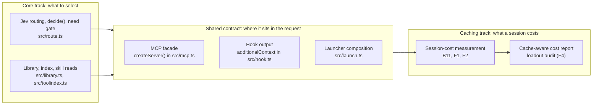

# Prompt-caching track

Handoff for the agent who takes this track. The items and their acceptance
criteria are in [BACKLOG.md, section F](BACKLOG.md#f-prompt-caching).
Commands for the OpenCode study are in [B11-HANDOFF.md](B11-HANDOFF.md).

## Why a separate track

loadout's core uses Jev to choose a short, task-specific context
([README](../../README.md)). Its cost argument is that such a context costs
less than a host that lists everything. Prompt caching weakens that argument:
the major providers reuse an unchanged request prefix at a fraction of the input
price. A static listing read from cache may cost little, and a loadout that
moved the prefix would lose the discount on everything after it.

B1's per-skill and per-tool overheads were measured on fresh first requests
([RESULTS](../../bench/RESULTS.md#b1-results-2026-10-07-what-installed-skills-cost-per-request)).
Savings over complete cached sessions are **not shown**. This track measures
them and keeps loadout's requests cache-friendly. Router quality stays with the
core. The two meet at a small contract.

## Boundary

**The caching track owns:**
- B11's harness and dataset: `bench/b11*.ts` and `bench/data/b11/`.
- The session-cost columns F2 adds to `bench/mcp-overhead.ts`, and per-request usage in `bench/outcome.ts`.
  B7's per-request study and its RESULTS entry stay with B7, in section B.
- The RESULTS sections of B11 and F1 to F5, and this file.

**The shared contract.** Either track may propose a change. It needs the pinning tests below to pass, and a PR
body that states the change's cache effect:
- which prefix position it changes (tools, system or messages);
- whether the change happens once per process, per session or per prompt;
- the test that pins it.

The contract covers three things:
- **MCP facade.** `createServer()` (`src/mcp.ts`) registers its tool names, descriptions and server instructions
  once per process.
  - They have two forms, chosen at start-up. A library with opted-in gateway servers gets the MCP wording and the
    gateway tools; one without gets the skills-only wording and no gateway tools.
  - Within either form, nothing depends on which servers the library holds, their order, or earlier calls
    ([D21](BACKLOG.md#d-integrations-and-robustness)).
  - loadout never sends `notifications/tools/list_changed`.
  - Search results, skill bodies and gateway listings arrive as tool results, after the prefix.
  - Pinned by D21's two tests in `test/loadout.test.ts`: byte-identical tool lists across inventories, and after
    discovery and loading. Also pinned by the test that lists the gateway tools only when the library has
    servers opted into it.
- **Hook output** (Claude Code and Codex). Per-prompt context goes only into `UserPromptSubmit`
  `additionalContext` (`src/hook.ts`). It is never system text, and never a change to the tool list. Pinned by
  the `hookOutput` assertions in "routes each prompt once per session and injects a clear winner"
  (`test/loadout.test.ts`).
- **Launcher.** `--append-system-prompt` and the per-launch tools and model (`src/launch.ts`) vary with the
  selection by design, so no test pins them. D21 recorded why moving that text was dropped: the launcher's tools
  already vary, and in Claude's cache order the tools come before the system prompt.

A core change that fails a pinning test is a cache regression, not a test to update. The rule to state the cache
effect is enforced in review. AGENTS.md lists it among what PRs must cover.

**Not owned** by the caching track:
- what Jev selects, routing quality and the need gate;
- library ingestion;
- the security boundaries: `escapeSkillTags`, `readConfined`, key handling through `resolveApiKey()`. The track
  may not relax any of them to save tokens.

## Goals

Each goal maps to backlog items, which hold the acceptance criteria.

1. **Cost per successful task over complete cached sessions, against the native host.**
   - On OpenCode with two free model families: B11.
   - On Codex: the C14 pilot ([#47](https://github.com/erik-hedstrom/loadout/pull/47)) is a first small sample.
   - On Claude Code: not planned.
   - Break-even listing sizes: B11's size sweep only.
2. **No loss of the cached prefix caused by loadout within a session, from the host's own usage counters:** F1,
   with F2's capture.
3. **Smaller fixed and per-discovery overhead, at unchanged task success on held-out cases:** F3.
4. **Cache-aware cost in the product:** F4. F5 covers start-up and path effects.

## State (2026-10-26)

- **On main:** D21 ([#59](https://github.com/erik-hedstrom/loadout/pull/59)) and B11's harness and pilots
  ([#57](https://github.com/erik-hedstrom/loadout/pull/57)).
- **Observations so far:** B11's [first pilot](../../bench/RESULTS.md#b11-pilot-2026-10-22-cached-opencode-sessions)
  and [replacement pilot](../../bench/RESULTS.md#b11-replacement-pilot-2026-10-23-quota-stopped).
- **Not shown:**
  - cost at retained quality;
  - break-even;
  - prefix continuity on any real host.

## Host caching rules

Retrieved 2026-10-22 from the providers' documentation. Recheck them before a write-up.
- **Anthropic** caches the exact prefix in the order tools, system, messages. Cache writes cost 1.25× input for
  5 minutes or 2× for 1 hour. Reads usually cost 0.1×, and 0.05× on Opus and Sonnet 5.5
  ([prompt caching](https://platform.claude.com/docs/en/build-with-claude/prompt-caching)). Claude Code places
  breakpoints itself, and documents that adding tools upfront invalidates the prefix
  ([host caching](https://code.claude.com/docs/en/prompt-caching)).
- **OpenAI** caches prefixes automatically from 1,024 tokens on GPT-5.6 and later. Writes cost 1.25× for the
  default 30-minute lifetime, or 2.5× for 12 hours. Reads cost 0.1×, or 0.05× on GPT-6.1 Sol. Earlier models have
  no write premium and model-dependent discounts
  ([prompt caching](https://developers.openai.com/api/docs/guides/prompt-caching)). The Codex CLI does not document
  its breakpoints or whether its tool list stays frozen across turns.
- **DeepSeek** and **Z.ai GLM** cache automatically, on a best-effort basis
  ([DeepSeek](https://api-docs.deepseek.com/guides/kv_cache/), [Z.ai](https://docs.z.ai/guides/capabilities/cache)).
  Their price tables list no write premium:
  - DeepSeek Flash's cache-hit input is $0.006 per million tokens against $0.30 for a miss, at peak
    ([pricing](https://api-docs.deepseek.com/quick_start/pricing/)).
  - GLM-5's cached input is $0.20 per million against $1 uncached
    ([pricing](https://docs.z.ai/guides/overview/pricing)).
- **OpenCode** does not document its serialization order or breakpoints. Treat the host and the provider's pricing
  as separate variables.

## Working rules

AGENTS.md applies in full. In addition, free-tier quota is the binding limit:
- size the sessions per day to it;
- resume across caps;
- write "not shown" for what a cap left unmeasured.
