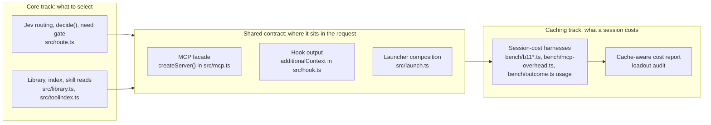

# Prompt-caching track

Handoff for the agent who takes this track. Items are in
[BACKLOG.md, section F](BACKLOG.md#f-prompt-caching). Commands for the
OpenCode study are in [B11-HANDOFF.md](B11-HANDOFF.md).

## Why a separate track

loadout's core is choosing skills, MCP tools and a model tier for each prompt
with Jev. Its cost argument is that a short, task-specific context costs less
than a host that lists everything. Prompt caching weakens that argument: every
host now reuses an unchanged request prefix at a fraction of the input price.
A static listing that is read from cache may cost little, and a loadout that
moved the prefix would lose the discount on everything after it.

B1's per-skill and per-tool overheads were measured on fresh first requests
([RESULTS](../../bench/RESULTS.md#b1-results-2026-10-07-what-installed-skills-cost-per-request)).
Savings over complete cached sessions are **not shown**. This track measures
them and keeps loadout's requests cache-friendly. Router quality is not part of
it: it stays with the core. The two tracks meet at a small contract (below).

## Boundary

**The caching track owns:**
- The session-cost harnesses: `bench/b11*.ts` and `bench/data/b11/`, and the usage capture in
  `bench/mcp-overhead.ts` (B7) and `bench/outcome.ts`.
- Their RESULTS sections, and this file.

**The shared contract.** Either track may propose a change. A change needs the contract tests to pass and a review
that names its cache effect.
- **MCP facade.** `createServer()` (`src/mcp.ts`) registers fixed tool names, descriptions and server instructions
  once per process. They do not depend on the library, the gateway inventory or earlier calls, and loadout never
  sends `notifications/tools/list_changed`. Search results, skill bodies and gateway listings arrive as tool
  results, after the prefix.
- **Hook output.** Per-prompt context goes only into `UserPromptSubmit` `additionalContext` (`src/hook.ts`). It is
  never system text, and never a change to the tool list.
- **Launcher.** `--append-system-prompt` and the per-launch tools and model (`src/launch.ts`) vary with the
  selection. D21 recorded why moving that text was dropped: the launcher's tools already vary, and they precede the
  system prompt in Claude's cache order.
- **Contract tests.** The D21 tests in `test/loadout.test.ts` compare the serialized initialization and tool list
  around search, skill loading and gateway discovery, and with permuted inventories. They run in CI on every PR. A
  core change that fails them is a cache regression, not a test to update.

**Not owned** by the caching track:
- what Jev selects, routing quality and the need gate;
- library ingestion;
- the security boundaries: `escapeSkillTags`, `readConfined`, key handling through `resolveApiKey()`. The track
  may not relax any of them to save tokens.

**Rule for both tracks.** A PR that touches the contract states its cache effect in the body:
- which prefix position it changes (tools, system or messages);
- whether the change happens once per process, per session or per prompt;
- the test that pins it.

## Goals

Each goal is done when its numbers are in `bench/RESULTS.md` with raw results, and README claims link to them.

1. **Cost per successful task over complete cached sessions:**
   - loadout against the native host, at retained task quality;
   - on at least two model families;
   - with cache reads, cache writes and uncached input priced separately, plus Jev's cost;
   - including the listing size at which loadout breaks even, per host and price profile.
2. **No prefix invalidation caused by loadout within a session, on every verified host.** The evidence comes from
   the host's own per-request usage counters: cache reads continue turn after turn with the hook and MCP active. The
   in-process D21 tests alone are not enough.
3. **Smaller fixed and per-discovery overhead, where measured:**
   - shorter constant descriptions and instructions;
   - fewer extra discovery requests.

   Recall on held-out requests must not drop. Bytes saved alone do not count.
4. **The cache-aware cost shows up in the product.** `loadout audit` reports first-request and cached-turn cost
   with the measured numbers, not with B1's fresh-request figures alone.

## Current state (2026-10-26)

- **Done:**
  - D21 made the MCP facade independent of the gateway inventory and pinned the contract tests
    ([#59](https://github.com/erik-hedstrom/loadout/pull/59)).
  - The B11 harness, its 72-task dataset and two quota-stopped pilots are on main
    ([#57](https://github.com/erik-hedstrom/loadout/pull/57)).
- **B11 observations** ([RESULTS](../../bench/RESULTS.md#b11-pilot-2026-10-22-cached-opencode-sessions)):
  - On OpenCode 1.19.3 with the free models, every retained request counter reported zero cache writes.
  - The native skill-heavy arms read cached tokens and still hit the deadline.
  - Free-tier quotas stop runs: GLM finished its share of the replacement pilot and DeepSeek did not
    ([RESULTS](../../bench/RESULTS.md#b11-replacement-pilot-2026-10-23-quota-stopped)).
- **Not shown:** cost at retained quality, break-even, and continuity on Claude Code and Codex hosts.
- **Running now:**
  - the replacement pilot's resume on the free models;
  - Codex trials at gpt-6-luna with medium effort, through the C14 harness
    ([#47](https://github.com/erik-hedstrom/loadout/pull/47)).

## Host caching rules

Retrieved 2026-10-22 from the providers' documentation. Recheck them before a write-up.
- **Anthropic** caches the exact prefix in the order tools, system, messages. Cache writes cost 1.25× input for
  5 minutes or 2× for 1 hour. Reads usually cost 0.1×, and 0.05× on Opus and Sonnet 5.5
  ([prompt caching](https://platform.claude.com/docs/en/build-with-claude/prompt-caching)). Claude Code places
  breakpoints itself, and documents that adding tools upfront invalidates the prefix
  ([host caching](https://code.claude.com/docs/en/prompt-caching)).
- **OpenAI** caches prefixes automatically from 1,024 tokens. On current models writes cost 1.25× and reads 0.1×,
  or 0.05× on GPT-6.1 Sol ([prompt caching](https://developers.openai.com/api/docs/guides/prompt-caching)). The
  Codex CLI does not document its breakpoints or whether its tool list stays frozen across turns.
- **DeepSeek** and **Z.ai GLM** cache automatically, on a best-effort basis. Flash reads cost about 0.02× input
  and GLM-5 reads 0.2× ([DeepSeek](https://api-docs.deepseek.com/guides/kv_cache/),
  [Z.ai](https://docs.z.ai/guides/capabilities/cache)).
- **OpenCode** does not document its serialization order or breakpoints. Treat the host and the provider's pricing
  as separate variables.

## Working rules for this track

- AGENTS.md applies in full: no proxying (usage comes from the host's own reports), keys only through
  `resolveApiKey()`, and the dev/test split.
- Every number needs a RESULTS entry, with negative results kept.
- Paid and agent-CLI runs happen in WSL from files, never inline, and each stays within its PR's stated Jev cap.
- Free-tier quota is the binding limit. Size the sessions per day to it, resume across caps, and write "not
  shown" for what a cap left unmeasured.
