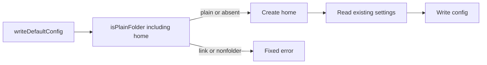

# E16 implementation handoff

Branch: `agent/e16-hygiene`, based on `635c80f`. Scope and remaining decision:
[E16 in the backlog](BACKLOG.md). The spawned-agent environment
policy is unchanged; Erik's decision note remains in the backlog.

Config writes must check the home before creating it or reading existing settings.
Cache and session callers keep the existing policy that permits a linked home.

- `src/cli.ts`: `addSources` strips C0/C1 controls from renamed skill names
  and skipped paths. Missing sources fail rather than printing them as empty
  packs. Failed adds, parser errors, unknown commands and unreadable/empty MCP
  token-file arguments use fixed diagnostics.
- `src/repo.ts`: `gitFiles` passes `withoutKey()` to `git ls-files`, preserving
  other environment variables and repository signals.
- `src/config.ts`: `writeDefaultConfig` checks the home before filesystem work.
  `src/safefs.ts`: `isPlainFolder(dir: string, checkHome = false)` adds the
  opt-in home check; existing callers keep their linked-home behavior.
- `test/hygiene.test.ts` covers real CLI output, the git process boundary and
  config targets behind symlinks/junctions. `test/init.test.ts` expects the
  fixed add failure message in its POSIX fake-git smoke test.

Verification on Windows:

- `npm test -- --maxWorkers=2 --reporter=dot`: 19 files passed;
  563 tests passed, 17 skipped. POSIX smoke tests skip on Windows; C0 filename
  cases run only on POSIX because Windows forbids those filenames.
- `npm run typecheck`, `npm run build`, `git diff --check`: passed.
- After restoring mutations: `npm test -- test/hygiene.test.ts test/init.test.ts
  --reporter=dot --maxWorkers=2`: 33 passed, 2 skipped; typecheck passed again.
- Mutation checks: 11/11 killed. Removed or weakened name/path stripping, git
  env filtering, config/home checks, missing-source rejection, add/parser/
  unknown-command diagnostics and both token-file diagnostics. Each produced
  assertion failures; every file was restored from its saved bytes.

Cost: $0 in Jev/API calls; no agent benchmarks or additional model runs.
Dependency installation reported one high-severity advisory; dependencies were
not changed by this task.

Review state: cross-model review, the fresh Codex review and full CI matrix are
pending with the coordinator. No push or PR was made. Review correctness/security
and necessity separately against the E16 acceptance criteria and AGENTS.md.
