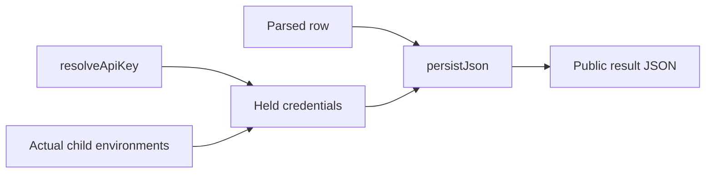

# E21: benchmark credential redaction

Implementation branch: `agent/e21-invoke-redaction`, based on `c2e08cf`.
Cost: $0. Only offline tests, fake providers and synthetic credentials were used.
No model CLI, Jev request, fetch, push, PR, git-config change or backlog edit.

## Findings and decisions

- P1 credential inventory: `bench/invoke.ts` holds the key returned by
  `resolveApiKey(config)` plus `envSecrets()` because both hosts inherit the
  parent environment (Claude overlays it; Codex passes no explicit env).
  `envSecrets(env = process.env): string[]` holds credential-named values and
  values matching production credential shapes. It excludes `TYPESAFE_API_KEY`
  before accessing values; that key is read only through its resolver.
- P1 whole-row persistence: invoke uses `persistJson(result, secrets)` at its
  append sink, including successful searches, decoded keys, hook metadata and
  other strings. Its console diagnostics are redacted too. Stderr is still
  redacted before the 400-character cut and after chunks have been joined.
- P2 encoded credentials: shared `redact(text, secrets)` accepts each held
  character literally or as UTF-8 percent bytes, including encoded hyphens,
  URI encoding, fully encoded strings and mixed-case hex. Raw matching remains
  case-sensitive and regex metacharacters are escaped. Empty values are ignored.
- `bench/redact.ts` contains the shared functions, separated from the A/B
  report's eager C15 manifest read. `ab-report.ts` retains its existing exports.
  A/B therefore receives the same encoding fix; it also collects inherited
  credentials and withholds encoded-credential-bearing raw streams.

## Sink audit

All `appendFileSync` / `writeFileSync` calls under `bench/` were inspected.
Other guarded result writers: `b11.ts` (rows, protocol and printed metadata),
`hook-latency.ts`, `judge.ts` (both phases and report), `listing.ts`,
`mcp-overhead.ts` (rows and preflight), `mismatch-probe.ts` (JSONL/text),
`need-probe.ts`, `outcome.ts` (metadata and verdicts), `overhead.ts` (rows,
preflight and report), `route-bench.ts` (rows/config) and `sweep.ts`.

B7/B12 use their allowlisted environments. B7 holds their union, including
preflight credentials and the launch OAuth token: metadata from a preflight can
reach a later row. B11 additionally holds its generated fixture transport token
and the current session's gateway token. B1 inherits the parent environment.
The TypeSafe key is resolved once by each run that can hold it.

Other writes are scratch/session configuration, fixtures or corpus generation
(`generate-tasks`, `seeds`, `expand`), or derived analysis (`need-audit`, `tune`),
not additional credential-holding result-row producers. Existing historical
result files and copied deliverables were not rewritten.

## Tests and mutations

New adversarial tests live in `test/bench-redaction.test.ts` and
`test/bench-sinks.test.ts`; existing A/B, B1, B7 and B12 test files add coverage.
They exercise actual parsed streams and file/console sinks, with process and
provider boundaries faked. Cases include opaque env/file TypeSafe keys, inherited
GitHub credentials, OAuth in an exit-0 search goal, encoded forms in nested values
and object keys, split stderr chunks, the stderr cut, empty values, metacharacters,
cleanup diagnostics and B11's two generated transport credentials.

The final mutation pass killed **44/44** mutants. Each relevant sink call was
deleted independently; additional mutants removed encoded matching, hex-case
support, regex escaping, empty filtering, environment collection, the TypeSafe
resolver boundary, shaped-value detection, key holding, generated token holding
and A/B stream withholding. Every original source was saved as bytes and restored
from that saved copy in `finally`; no `git checkout` restoration was used.
Raw final dispositions: [E21-MUTATIONS.json](E21-MUTATIONS.json).
An earlier pass killed 34/43; surviving mutations exposed test gaps, which were
covered before the final pass.

## Verification and handback

- `npm ci --ignore-scripts`: exit 0, 173 packages installed, 0 vulnerabilities.
- `npm run build`: exit 0.
- `npm run typecheck`: exit 0.
- `git diff --check` and staged check: exit 0 after removing a trailing blank
  line caught by the raw staged check (initially exit 2).
- `npm test -- --maxWorkers=2`: exit 0; 37 files passed, 5 skipped;
  1,232 tests passed, 129 skipped; 124.57 seconds. Existing platform-dependent
  skips remain on Windows. The run used a scratch `LOADOUT_HOME` and fake keys.
- UTF-8 BOM scan: no BOM in all 23 changed/new files or the commit message.

The initial full-suite run also passed (1,213 tests, 129 skips) before the
remaining sink regressions were added. Initial reproduction failed 9 of 11
adversarial cases against the unfixed code; all now pass. Intermediate fixture
setup errors (dynamic-import resolution and a fake-client import) were fixed;
the B7 cross-child metadata leak exposed by the new test was fixed in production.

The orchestrator owns E21's backlog row, independent reviews, CI, push and PR.
No independent cross-model review was run by this implementation child.
