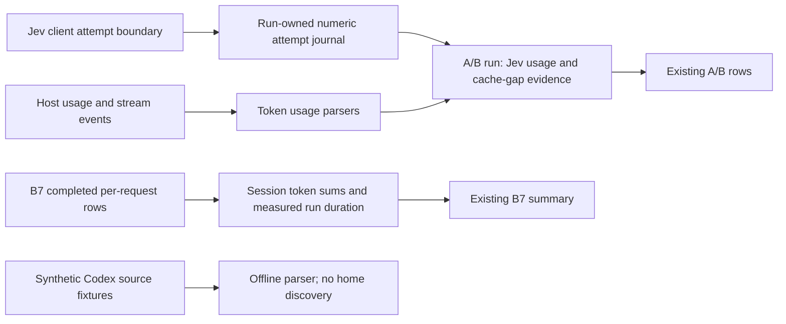

# F2 offline capture work

This implements the columns in [F2](BACKLOG.md#f-prompt-caching). No live
measurement or Codex-home access is authorized by this document.

The cross-process Jev channel is an offline prototype pending Erik's channel
decision. `LOADOUT_BENCH_JEV_USAGE`, forwarded to the hook and MCP, names a
private run directory containing a harness marker. Each event creates a new
record using exclusive creation; no existing file is opened for writing. It does not change
their prompt output or tool schemas. No product CLI command was added.

Jev input cost uses the configured input-token price, as `route()` does. The
attempt boundary counts retries, including failures. Unreported counters or
unfinished attempts make total cost unknown; reported cost stays a lower
bound. Output has no configured price, so nonzero output keeps complete cost
unknown even with complete token usage. Journal data contains only counters and controlled statuses, never
prompts, URLs, credentials or host paths. It is private temporary run data.

Request duration is **not shown**: `lib.run()` buffers
stdout and Claude emits no documented request-start event. It is distinct
from completion-to-completion `gapMs`; no streaming-duration proxy is used.
Subagents do not enter the main-thread continuity chain. Host/version/model and
request-versus-turn granularity remain on the containing run. Codex request
count is unknown while only turn totals exist. Legacy rows omit new fields.

Cache-gap evidence starts with the last main-thread request of the previous
valid run of the same host and arm, including its lifetime and timestamp.
New cache-gap flags use an observed Claude write lifetime when a single
5-minute or 1-hour bucket establishes it. Mixed buckets, read-only requests
and Codex retention are unknown. Capture-v1 reports render flagged, clear or
unknown explicitly. Codex rows always report unknown: the selected retention
policy is not exposed by this capture, so no documented bound establishes an
expiry flag for these runs. The proposed Codex-only C14 milestone would
therefore have no cache-gap flags. A gap flag never establishes expiry.
Missing Codex writes retain the legacy zero projection for existing callers,
with an explicit availability flag; new reports render the write and
dependent uncached buckets as `not shown` in A/B, native-arm and B7 output.
Historical rows without the flag keep their original formatting. The
candidate source parser returns null for missing writes. The Jev journal
reads original counters before routing's legacy numeric projection.

The cache-share formatter now emits `<100%` for a partial hit that would
round to 100%, and `not shown` for a zero denominator. These two corrections
can change historical edge-case formatting. The C14 rerun and a legacy
C15-shaped report reproduce main's pinned `ecb8fe3` reporter byte-for-byte in
tests, including its existing hook-trust notice provenance.

B7 rollups sum the existing measured rows only; the unmeasured canary is
excluded from tokens and request count. Run duration includes startup,
measured turns and the canary. Codex's legacy single-turn row remains a turn
total, not evidence of individual model requests.

The session-shape plan and source decision remain proposals pending Erik's
approval. No B7 shape extension is implemented; B7 remains after v0.1.
F1's plan uses at least five persistent user turns per on/off arm, compares
on against off at the provider's reporting granularity, and treats provider
misses without established causes as unknown. It requires per-turn MCP-ready
timing, including restarts on Codex resume and OpenCode continue. Its harness
and runs are pending source/budget/Claude-arm decisions. The decision packet
lives outside this repository.
F1 prefix continuity, net savings and retained quality are not shown.

## Journal trust boundary

Before each exclusive create, the writer verifies an absolute canonical
directory, no symlink/junction ancestors, mode 0700 on POSIX, and the fixed
marker's regular-file identity, single link and contents. Pricing must be a
finite non-negative number before any record is written. Invalid pricing or
persistence failures use fixed diagnostics. Malformed/unreadable records
make accounting unknown without discarding the completed host row.

The bounded residual race is a directory swap after validation. Exclusive
creation may then leave one new numeric record at the substituted location;
an existing file, symlink or hard-linked destination cannot be overwritten.
This is not protection against an actor who can read/change the benchmark
process or its private directory. Journal contents are not authenticated
against such an actor and are not authoritative billing records. The run
root and its records are temporary and removed after collection.
