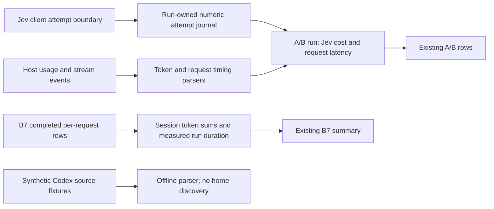

# F2 offline capture work

This implements the columns in [F2](BACKLOG.md#f-prompt-caching). No live
measurement or Codex-home access is authorized by this document.

The cross-process Jev channel is an offline prototype pending Erik's channel
decision. It uses a private, run-owned file named explicitly in
`LOADOUT_BENCH_JEV_USAGE`, forwarded to the hook and MCP. It does not change
their prompt output or tool schemas. No product CLI command was added.

Jev input cost uses the configured input-token price, as `route()` does. The
attempt boundary counts retries, including failures. Unreported counters or
unfinished attempts make total cost unknown; reported cost stays a lower
bound. Output has no configured price, so nonzero output keeps complete cost
unknown even with complete token usage. Journal data contains only counters and controlled statuses, never
prompts, URLs, credentials or host paths. It is private temporary run data.

Request duration is **not shown** (`latencyMs: null`): `lib.run()` buffers
stdout and Claude emits no documented request-start event. It is distinct
from completion-to-completion `gapMs`; no streaming-duration proxy is used.
New request rows identify the timestamp source and previous main-thread
input; subagents do not enter that continuity chain. Host/version/model and
request-versus-turn granularity remain on the containing run. Codex request
count is unknown while only turn totals exist. Legacy rows omit new fields.

New cache-gap flags use an observed Claude write lifetime when a single
5-minute or 1-hour bucket establishes it. Mixed buckets, read-only requests
and Codex retention are unknown. A gap flag never establishes expiry.
Missing Codex writes retain the legacy zero projection for existing callers,
with an explicit `unreconciled` warning; the candidate source parser returns
null for missing writes. Jev's legacy zero projection now carries
`usageMissing`; the journal reads original counters before that projection.

The cache-share formatter now emits `<100%` for a partial hit that would
round to 100%, and `not shown` for a zero denominator. These two corrections
can change historical edge-case formatting. The C14 rerun and a legacy
C15-shaped report reproduce the base reporter byte-for-byte in tests.

B7 rollups sum the existing measured rows only; the unmeasured canary is
excluded from tokens and request count. Run duration includes startup,
measured turns and the canary. Codex's legacy single-turn row remains a turn
total, not evidence of individual model requests.

The session-shape plan and source decision remain proposals pending Erik's
approval. No B7 shape extension is implemented; B7 remains after v0.1.
F1's plan uses at least five persistent user turns per on/off arm, compares
on against off at the provider's reporting granularity, and treats provider
misses without established causes as unknown. It requires per-turn MCP-ready
timing, including restarts on Codex resume and OpenCode continue. Its harness
and runs are pending source/budget/Claude-arm decisions. Full details and
private access decisions are in the coordinator's decision packet.
F1 prefix continuity, net savings and retained quality are not shown.

## Offline verification

2026-11-04, Windows Node 24: `npm test -- --maxWorkers=2` passed 1,365
tests with 130 platform skips (46 files: 41 passed, 5 skipped).
`npm run typecheck` and `npm run build` passed. A final focused accounting/
parser check passed 31 tests with one Windows symlink skip. WSL Node 24.15.0
separately passed numeric-journal writing, symlink refusal and CRLF Codex
fixture parsing, with no host/model calls. `git diff --check` passed.

The first focused run failed one existing command-contract assertion because
the journal environment name was forwarded without capture being enabled;
conditional forwarding fixed it. Its A/B/F2 recheck passed 160 tests with
10 platform skips. Full-matrix CI and both reviews are pending the
coordinator; no reviewer was started by the implementer. Cost: $0.
